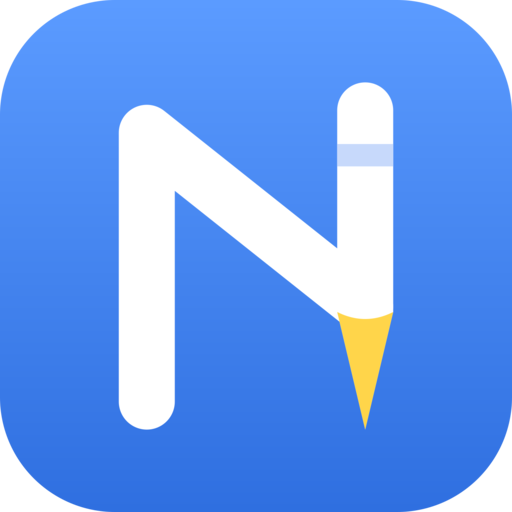

<p align="center"></p>

# Notation

A note-taking and PDF-annotation app for Linux, Windows, macOS, Android and iOS (one Flutter code base). Pen and
shapes, text boxes, formulas, PDFs, live collaboration, a calendar with tasks, a graph of what the notes say, and AI
features that run on the device by default.

* How the code is organised, the conventions and how to add a feature: [docs/architecture.md](docs/architecture.md)
* The knowledge graph: [docs/graph-architecture.md](docs/graph-architecture.md)

In the facts graph a topic (or all facts) can be studied: **Flashcards**, a **Quiz** whose answers the AI grades (weak questions come back first) and **Ask**, which answers from the facts alone (after OpenKnowledgeBase's study tools).
* Extensions and automations, the whole API (and *Create with AI*): [docs/extensions.md](docs/extensions.md)
* Letting an AI agent on your computer use your notes (MCP server): [docs/mcp.md](docs/mcp.md)
* The sections below describe what each feature does for the person using it.

## License

Notation is free software under the [GNU Affero General Public License v3.0 or later](LICENSE) (`AGPL-3.0-or-later`). You may use, study, change and share it; if you distribute a modified version, or run one as a network service, you must offer its source under the same license. Third-party components keep their own licenses (see `assets/licenses/`).

## Building and testing

```
flutter pub get
flutter run -d linux                 # or windows, macos, an Android/iOS device
flutter analyze
LD_LIBRARY_PATH=build/linux/x64/debug/bundle/lib flutter test     # (Linux; build the app once first)
flutter build appbundle --release    # Android, for the Play Store (one APK for all three CPU kinds is 260 MB: --split-per-abi for APKs)
```

A release build is signed with the key in `android/key.properties` (never committed; `storeFile`, `storePassword`, `keyAlias`,
`keyPassword`). Without it the build falls back to the debug key and says so: such an APK cannot be published. Create a key with
`keytool -genkeypair -v -keystore ~/upload.jks -keyalg RSA -keysize 2048 -validity 10000 -alias upload` and keep it (and its passwords)
somewhere safe: a lost key means no more updates under the same app id.

`.github/workflows/ci.yml` runs `flutter analyze`, the tests (on a Linux debug build) and an Android debug build for every push and pull request.
`.github/workflows/builds.yml` makes the release builds (iOS and macOS unsigned, Windows, Android APKs, Linux as a Flatpak from
`linux/flatpak/`) for every push to `main` and on request ("Run workflow"); the results are under *Artifacts* on the run page and
kept for three days.

The language models, the handwriting and speech models and the dictionaries are downloaded from inside the app when
a feature that needs one is first used (Settings → AI and models); none is bundled.

## Note files (`.uninote`)

A note can be saved as a single file: a ZIP archive with `manifest.json` (text, text boxes,
highlights, page setup), `strokes.bin` (packed pen strokes), `source.pdf` for a note made from a
PDF, and `media/` for pictures. The exact layout is documented at the top of
`lib/data/note_file.dart`. Save one from a note (the save button in the top bar, or the note's
menu), open one from the dashboard or a folder's menu, or add the automation "Save the note as a
file" (Automations tab) to have a file written by itself, into a folder, when a note was changed.

## Live collaboration

Several people can work on one note at the same time. Start a session from the group button in a
note's top bar, send the invite link (`notation://join?s=<server>#<secret>`) and let people in when
they ask; they get a copy of the note, and everything drawn or written shows up for everyone.

- **Zero knowledge.** Every message, including the connection set-up, is sealed with
  XChaCha20-Poly1305 under a key derived from the secret in the link. The secret is after the `#`,
  so it never reaches a server. The signalling server and any TURN relay see only ciphertext (and
  metadata: addresses, sizes, timing).
- **Joining.** The host sees who asks and a six-digit code that appears on both screens.
- **Transport.** WebRTC data channels, host in the middle (guests connect to the host, which relays).
  A *signalling server* introduces the devices. There are three interchangeable implementations in
  `tool/signaling/` (Node, Dart; the Cloudflare Workers one is in its own repository, `note-signaling-cf-worker`) that share one protocol and one conformance test
  suite (`SIGNALING_URL=ws://... flutter test test/collab/signaling_test.dart`). The app uses the
  built-in server (`lib/collab/defaults.dart`) unless you choose your own in Settings → Live collaboration
  (the settings can test an address before using it).
- **Merging.** Every stroke, text box, picture and highlight has an id; a change replaces an element as a
  whole and the later one wins (Lamport clock), a deletion beats a change made without knowing of it.
  Text boxes and the written document are replaced as a whole: two people typing in the *same* box at
  the same moment lose one of the edits.
- **Limits of this version.** The host must stay online and keep the app running; the strokes of others
  appear when they are finished, not while being drawn; undo is local and can undo only what it still finds.
- Code: `lib/collab/` (replica = merging, session = protocol, signaling, WebRTC), UI in
  `lib/screens/collab_ui.dart` and `editor_collab.dart`.

### Who is looking at which page

In a live session every device tells the others which page it has in view (a small message, sealed like the rest). On the
page itself a coloured border and a tag with the person's name show where somebody else is; beside the scrollbar a dot with
their initial sits at the height of their page, and the live panel lists everyone with their page and a "Go to the page"
button. Your own page is not framed. (`lib/screens/presence.dart`, `CollabSession.announcePage`)

### Copies that work while you are offline

A live session needs the host online. *Share a copy that works offline* (in the live panel) seals a copy
of the note with a fresh key, puts the sealed file in `Notation shared/` on the Nextcloud connected in the
calendar settings, makes a public link to it (for 30 days) and gives out
`notation://copy?u=<download address>#<key>`. The key is only in the part after the `#`, so the Nextcloud
holds a file it cannot read. Whoever opens the link downloads it, opens it with the key and gets a note of
their own. (`lib/collab/cloud_share.dart`)

The storage is a `ShareStorage` (`lib/collab/share_storage.dart`): a name, `available`, `upload(sealed)` that returns a
public address, and optionally `handles`/`fetch` for links that need the service's own way of downloading. Services:

| Service | Set up by | Link lasts | Notes |
| --- | --- | --- | --- |
| Nextcloud / ownCloud | the calendar connection | 30 days | WebDAV + sharing API |
| S3-compatible (R2, B2, Wasabi, MinIO, S3) | Settings → Sharing copies | 7 days | own SigV4 signing, signed link; no app registration |
| Dropbox | sign-in in the browser | 30 days (the app deletes its copies) | needs `dropboxAppKey` in `collab/defaults.dart` |
| OneDrive (personal) | sign-in in the browser | 30 days (the app deletes its copies) | needs `oneDriveClientId`; work/school accounts often forbid anonymous links |

Dropbox and OneDrive are always listed in the settings but need an app registration: the build's (the steps and the
redirect `notation://oauth/<service>` are in `collab/defaults.dart`) or one the person enters in the settings; the sign-in is OAuth with PKCE, no secret in the app.
Copies on S3, Dropbox and OneDrive are deleted from the service the next time something is shared after they are
past their time. Another service is one more class (`store` and `replace`, plus `handles`/`fetch` if its links are not plain
downloads) and one more entry in the list in `main.dart`.

**Marker and knocking.** Next to each copy there is a second small file (`lib/collab/live_marker.dart`), sealed
with a key derived from the secret of the copy's link, so that the public file says nothing without the link. It
holds the invite to a room on the signalling server (and until when it counts). While the owner's app runs it
waits in that room (`lib/collab/standby.dart`) and renews the marker every 4 minutes; a marker that is not renewed
runs out after 10 minutes (and says "not here" at once when the app goes to the background). Whoever opens the
link while the marker is fresh joins the room and knocks; the owner's app answers by starting a live session in
that room (in the editor if the note is open, else without a screen) and tells the owner. The guest proves that they
have the copy's link (a keyed proof in the join request), so they come in without the owner being asked; anyone
who only has the room's invite is still asked. The storage provider sees a file being rewritten now and then, not
what is in it.

**Edits made while the owner is away.** A copy remembers how it was when it was received (digests of its
elements, `lib/collab/note_delta.dart`). What the guest changes since is sealed and left in the *inbox* of the
copy (a Nextcloud folder shared as a "file drop": guests can add files but not read or change any;
`lib/collab/inbox.dart`). The owner's app looks in the inbox now and then and takes in what is new into the note
(into the running session, the open editor or the saved note), once per change. When the owner comes online
instead, the copy joins their session by itself and its changes go with it. Only Nextcloud has an inbox:
Dropbox and OneDrive give no upload-only address that works without the guest signing in (Dropbox's temporary
upload links are single-use and last 4 hours; OneDrive's anonymous "edit" links ask for a sign-in), so on
those, edits made offline reach the owner when both are online at the same time. (S3 could have one with
pre-signed upload addresses in the marker; not done.)

**Edits the owner makes while the guest is away.** The owner's app puts the copy up again (in place, same
address) when the note changed since it was last put up: when the note is left, when the app goes to the background
or the window is closed, and at every renewal of the marker (4 minutes). The marker carries the copy's version. The
guest's app reads it every minute and, when it is newer than what it took in, downloads the copy and takes in what the
owner changed since: new, changed and deleted things, except those the guest changed meanwhile, which stay (and still
go to the owner's inbox). Without a network nothing is lost: an upload that fails is tried again at the next renewal
or when the app is back, and a failed write never stops the ones after it. Copies shared before this existed are not
kept up to date (the app did not keep their address).

**Shared notes.** Notes that came from other people (a copy opened from a link, or a session joined) are in the
folder "Shared with me" of the folder view, and notes that are shared in either direction have a group symbol on the
dashboard and in the folder view (`lib/collab/shared_notes.dart`).

### Sharing with people at the same cloud service

Besides links, a note or a whole folder can be shared **with a person who has an account at the same cloud service**, as the service
itself understands sharing: you invite them by name, they see it in their own account, you give them *Can view* or *Can edit*, and you can
take them out again. Both sides then keep their copies in step in the background, like the sync of one's own devices (it is an extension of
the cloud sync: the same engine, `FolderSync`, run for the shared note or folder only). The files are **not sealed** (the service does the
access control, and can read them); locked notes cannot be shared. A note of a share that is open on two people's devices at once is worked on **live**, like one that is open on two of your own devices. From the note's live button (*Share this note with a person*), or the
folder menu (*Share with people...*); what was shared with you waits in *Settings → Sharing and files → Shared with people*. Nextcloud
works against a real server; OneDrive and Dropbox are built from their documentation and tested against fakes only (a OneDrive share is found from a link the sender passes on; Dropbox needs an app with access to the whole Dropbox). How it works, what a participant can and cannot reach, and what each service needs:
[docs/native-sharing.md](docs/native-sharing.md). (`lib/nativeshare/`)

## Sync profile: several devices, one person

*Settings → Sync profile* (and the first screen of the app) connects your devices: the same id and name, the same notes and
folders (with their pictures), the same settings. Add a device with a link or the QR code next to it (the new device scans it
with the button in "Use a link from another device"); both screens show six digits to compare and you say yes on the first one.
The devices then connect directly (WebRTC), prove who they are to each other with a secret each device keeps to itself, and
bring their libraries together. With "Keep my devices in sync automatically" on (opt-in: it tells the signalling server that a
device of yours is online) they do it again whenever two of them are online together; otherwise press "Sync now" on both. How
it works, what is and is not shared, and the server side: [docs/profile-sync.md](docs/profile-sync.md).

With the automatic sync on, a note that is open on two of your devices at once is worked on **live**: the two copies follow each
other as you draw and type, like a shared session but with no link and no asking (the devices have proved who they are).

Devices that are never online together can sync through a **cloud folder** (Nextcloud, S3, Dropbox or OneDrive): *Settings → Sync
profile → Sync through a cloud folder*. The files are encrypted or plain, as you choose, and the cloud accounts themselves are handed
to your other devices when two of them sync directly. Working on a note live goes through the signalling server either way (what the
devices tell each other there is encrypted); when nobody else is left in a session, the host puts the changed note up.

## Reading handwriting ahead of time

The automation *A note is opened → Read the writing and formulas ahead of time* (choose handwriting, formulas or both)
makes converting writing instant. While the note is open, the pen strokes that lie close together on a page are
grouped into blocks (`lib/ink/ink_clusters.dart`: a letter's size apart counts as close; the highlighter, long lines and
frames, and lone dots are left out; a page of writing is cut into lines). After things have been quiet for a moment,
and never while a stroke is being drawn, each block whose ink is new or changed is read in the background, one at a
time, with the handwriting reader and, where the text has signs of maths in it or parts are stacked (a fraction, a
power), also with the formula reader (`lib/ink/ink_prefetcher.dart`). What the models read is kept by the block's strokes
as they are: another stroke, a moved one or an erased one is another block and is read again; blocks that are gone are
forgotten. Selecting some blocks with the lasso (exactly whole blocks) and choosing *Convert handwriting to text* or
*Convert a handwritten formula to LaTeX* then shows the result at once instead of reading it then; a green dot on the
button says the result is ready. A selection that cuts a block is read as before. The readers are used one job at a
time: a conversion that is asked for goes after the piece being read and before the next. Nothing in the note is
changed by the reading. It needs the models from the settings, and the AI switch and the tools *Handwriting to text* /
*Handwritten formulas* on.

The handwriting reader is **GLM-OCR** (MIT) or PaddleOCR-VL 1.5 (Apache 2.0), a choice in Settings, *Handwriting*, kept in `handwriting_reader` (GLM-OCR unless chosen otherwise; TrOCR, the reader of earlier versions, was taken out on 2026-11-10: it was trained on the IAM database, which is only for research, and read a third as well; its files are deleted from the device at the start). **GLM-OCR** (`lib/ink/glm_ocr*.dart`, `onnx_glm_ocr.dart`) is a vision-language model of 0.9 billion parameters that reads a whole line of ink as a picture (`renderInkForGlmOcr`: 140 pixels high, a multiple of 28 wide, cut into 14 x 14 patches in blocks of 2 x 2) and writes the text with a language model's idea of which words are likely. The app runs two ONNX networks made from it by `tool/handwriting_bench/glm_onnx/` (the vision network with 8-bit weights, 430 MB; the language model with 4-bit weights, 297 MB; plus its table of word vectors as int8 rows, 88 MB: about 815 MB to download from `huggingface.co/nfa04/glm-ocr-onnx` (the original model converted and quantised, not retrained), checked against SHA-256 sums); unlike the Paddle files the language model is given the three-part rotary positions of the picture (`glmPromptPositions`, checked against the Python of the model). On 68 lines of real handwriting (German, English and a little maths; `tool/handwriting_bench/`) it reads with a character error rate of 11 % against 43 % for TrOCR (the old reader) and 31 % for PaddleOCR-VL as the app ran it; the 8-bit/4-bit files read as well as the full ones (11.2 %). The vision network is three quarters of the time (about 2.3 seconds a line on a desktop at 10 rows of patches, 1.5 at 8 and 1.0 at 6: the *Standard*, *Quick* and *Light* choices, with 10.8, 12.0 and 14.3 % error; it grows with the square of the rows). It tends to write maths as LaTeX and to turn a German word into the English one; nothing corrects that. The quantisation, speeds and every number are in `tool/handwriting_bench/README.md`. PaddleOCR-VL (`lib/ink/paddle_vl*.dart`, `onnx_paddle_vl.dart`) is a vision-language model of 0.9 billion parameters, run in ONNX Runtime from the 4-bit files of `onnx-community` (vision network 231 MB, language model 234 MB, table of embeddings 424 MB read row by row from its file, tokenizer 11 MB: about 900 MB to download, a gigabyte or two of memory while it reads). Each line of ink is drawn 112 pixels high, cut into 14 x 14 patches, and the model is asked `OCR:`; it writes the line with a language model's idea of which words are likely, which the small readers lack. On printed text set in an italic font (two lines, English and German with umlauts) it read both exactly, about 6 seconds a line on a desktop in a debug build (`integration_test/paddle_vl_onnx_test.dart`); on a tablet it will be slower. The decoder has no input for the 3-D positions the model was trained with, so the picture's tokens get plain running positions; that read fine on those lines. A line it cannot read may come out as LaTeX (`\(x^{2}\)`), and a loop it falls into is cut off. How it compares with TrOCR on real handwriting is not measured yet.

## Checking maths

The tool *Check my maths* (Maths group; off or on in the settings, on with the maths preset) marks what you write
as right or wrong, a little behind the pen. While it is on and the formula model is installed, the writing is read in
the background (`lib/ink/ink_prefetcher.dart`, in rows mode: a block of several lines is cut into rows by
`rowsOf` in `lib/ink/ink_clusters.dart`; the parts of a fraction or a power stay in their row: a bar with its numerator and denominator, also in a line of
several fractions, and the stroke over a root with what is under it, are one piece before the rows are told apart; and a flat stroke such as the bars of `=` reaches further when
strokes are grouped into a block, because the room people leave around a sign is wide; lines that touch, such as a heading with its underline over the line below it, are
cut where the middles of their symbols step from one line to the next, flat strokes and dots not counting; and a word with a colon, then a good way off a formula (`Translation:   m g - 2F = m a`), is cut into
the label and the formula, so that the formula reader is not given the word). Rows that follow each
other (below, close, about under each other, and each read as maths) are one worked solution
(`lib/ink/math_marks.dart`), checked by `checkLines` in `lib/algebra/checker.dart`. A tick, a cross or a warning appears
beside the line; tapping it (not while drawing) says what was found, with an example, and what it should be.
**Is it a misreading?** A line that is marked as a mistake is read once more in the background, with a thinner and a thicker pen than usual (0.7 and 1.4 times
the pen of the picture TexTeller gets: `MathService.recognizeAgain`, `InkPrefetcher.lookAgain`). If one of those readings is not a mistake in its place (the lines around it as they are), the mark is an
orange question mark, "I am not sure I read this right", instead of the red cross; a mistake that every reading shows stays a cross. The sheet of a mark offers the other readings (*Or did you write:*, tap to take one) and
has a *Read it again* button for any line (once for each; it then says when the line reads the same). Measured on 400 MathWriting inks (`tool` harness, not in the repository): reading at 0.5, 0.7, 1, 1.4 and 2 times the
pen gives 65.5 %, 67.5 %, 69.0 %, 64.5 % and 59.0 % exact; where the three readings 0.7, 1 and 1.4 agree (296 inks) the usual one is right for 78 %, where they differ (104 inks) for 42 %; when the usual
reading is wrong, one of the other two is right for 20 % (and they differ from it for 48 %); a majority vote of the three gains only 0.5 points, so the usual reading is not replaced by itself. The old reader has no other way to look.

In the sheet of a mark and of the manual check, what was read is in a field: if the model misread the writing, correct it and the line is
checked again at once (a correction in a mark's sheet stays while the note is open and the line is not written over).
Circling some maths with the lasso and pressing the *rule* button next to the trash button checks just that, now: each
line is read and the sheet lists them one by one (also for lines the background check has not reached).

Everything is worked out numerically with the app's own small algebra engine (`lib/algebra`): two expressions are the same
when they agree at many points (fixed ones and random ones from ranges that also suit roots and logarithms), which is
robust for the algebra of a course. What is checked: arithmetic (with rounding: `1/3 = 0.333` is right up to rounding),
chains `a = b = c`, identities, lines that go on with `=`, derivatives, integrals (the derivative of the result has to be the
integrand; definite ones by number), limits (from both sides, or towards infinity), sums with whole-number limits,
factorials and binomials, and steps of solving an equation: a line is right when it has the same solutions as the one above
(same up to a factor, else the real roots are compared). A step that drops a solution (dividing by x) or adds one (squaring)
is flagged with a warning and names it, unless the line is joined to the one above by an arrow: `\Rightarrow`, `\rightarrow`, `\to`, `⇒`, `→` say that the new line follows (squaring is fine, dropping a solution is not: `x^2 = 4 \Rightarrow x = 2` is wrong, and the sheet names `x = -2`); `\iff`, `⇔` say both ways. An arrow at the start of a line goes on from the line above. `x = \pm 2`, "or" and lists of solutions work. A line that ends with `=` gets its result
(a value, a derivative, an integral).

**Sums, products and factorials with a letter** (`\sum_{k=1}^{n} k = \frac{n(n+1)}{2}`, `\prod_{k=1}^{n} k = n!`, `(n+1)! = (n+1) \cdot n!`,
`\binom{n}{k}`, the step of an induction proof) are tried for whole numbers of the letter in the limits, 1 to 12 (`Series` in `lib/algebra/expr.dart`);
with such a sum or factorial on a side the line is a claim, not an equation to solve. `\sum_{k=1}^{n} k = 55` (the letter on one side only) is
still an equation and says nothing.

**Inequalities** (`<`, `>`, `\le`, `\ge`, `\ne`, also joined by "or" / "and", `lib/algebra/checker_relations.dart`): one with numbers only is right or not
(`5 < 3`, and the sheet says `5 > 3`). A line against the one above it must have the same solutions, found by trying the points where the sides meet,
the stretches between them and a grid: a sign that was not turned over after dividing by a negative number (`-2x < 6` then `x < -3`) is wrong, and the
sheet gives the solutions of the line above (`x > -3`); a line that drops part of the solutions (`x^2 \ge 4` then `x \ge 2`) *loses* them and says which
(`x \le -2`); one that lets in more *widens* them. After an arrow (`\Rightarrow`) the new line only has to follow, so squaring is fine and a stricter
line is not. Lines about sets (`\in`, `\cup` ...) are left alone.

**Matrices** (`lib/algebra/matrix.dart`, `checker_matrix.dart`): `pmatrix`, `bmatrix`, `matrix`, `array` and `vmatrix` (its determinant) of numbers or
formulas, with sums, products, a number times a matrix, `^T`, `^{-1}`, whole powers, `\det A`, `|A|` and `I`. A letter can name a matrix (`A = \begin{pmatrix}...`,
also `A = ..., B = ...` in one line and `\mathbf{A}`) for the lines after it. A wrong product is flagged with the right matrix; sizes that do not fit
(`2 \times 3` times `2 \times 3`) and an inverse that does not exist are told as such. A matrix with letters is tried at several values. The matrices of a line
are taken out before it is split at `\\` and `&`.

**Rounding, remainders and divisors**: `\lfloor x \rfloor`, `\lceil x \rceil` (also `⌊ ⌋ ⌈ ⌉`), `a \bmod m` (also `\mod`, `mod`; `a + b \bmod m` is the sum taken
mod m, as in number theory), `\gcd(a, b, ...)`, `\lcm`, `\min`, `\max` (`Call` in `lib/algebra/expr.dart`). A letter in `\bmod`, `\gcd` or `\lcm` is tried at whole
numbers only, and so is one in a floor or ceiling when it is a letter people count with (`i`-`n`): `\lfloor n/2 \rfloor + \lceil n/2 \rceil = n` holds,
`\lfloor n/2 \rfloor + \lfloor n/2 \rfloor = n` does not (`\lfloor x \rfloor = x` is left alone: it may ask for the x). Euclid's algorithm line by line, `(a + b) \bmod m = ((a \bmod m) + (b \bmod m)) \bmod m`
and the like are checked. **Congruences**, `a \equiv b \pmod{m}` (also `(\mod m)`, chains `a \equiv b \equiv c \pmod m`): the difference has to be a multiple of m; with letters they
are whole numbers, and the sheet says what the left side is mod m.

**Logic** (`lib/algebra/logic.dart`, `checker_logic.dart`): lines with `\land`, `\lor`, `\neg`, `\oplus`, `\to`, `\leftrightarrow` (also `∧ ∨ ¬ ⊕ → ↔`, `\overline{p}`, `p'`, `\top`, `\bot`) are
compared by their truth tables, up to ten letters. `\equiv`, `\iff` and `=` (when a sign that is only logic is in the line) say "the same"; an arrow on its own says "so"
(the new formula has to follow: no row makes the first true and the second false); a line that begins with such a sign goes on from the line above, so a derivation
`\neg(p \to q)`, `\equiv \neg(\neg p \lor q)`, `\equiv p \land \neg q` is checked step by step. A wrong one shows the row that tells the two apart (`p = 0, q = 1: 1 \neq 0`).
Binding, strongest first: `¬`, `∧`, `⊕`, `∨`, `→` (to the right), `↔`. A list of solutions with "or" (`x = 2 \lor x = 3`) and the transpose (`A^\top`) are not logic
and are read as before; the line is only read as logic when all of it is.

**Truth tables** (`lib/algebra/truth_table.dart`, `lib/screens/truth_table_dialog.dart`): the grid button in the insert bar (with *Tables* on) and the *Truth table* button in the sheet of a line
of logic open a dialog. Type a formula as `p -> q`, `!p | q`, `(p and q) or not r` or in LaTeX (`\land \lor \neg \oplus \to \leftrightarrow`, `∧ ∨ ¬ ⊕ → ↔`, `0`/`1`/`true`/`false`), or two
to compare with `=` (the same in every row?) or `|=` (does the second follow?). The table has a column for every part of the formula (the letters first, the whole last and shaded), rows
counted up from all false or down from all true, `1 0` or `T F`; it says whether the formula is always true, never true or sometimes (and in how many rows), and under *Other forms* gives the
rows that are true and false, the shortest sum of products and product of sums (Quine-McCluskey, up to ten letters) and the canonical forms. *Copy as Markdown / LaTeX* copies the table, *Put on the
page* makes a table text box (the written document: a Markdown table at the cursor; up to 64 rows).

**Statistics** (`lib/algebra/statistics.dart`, the sample mean in `latex_parser.dart`):
- *Values and their mean.* `x_i` inside a sum is the i-th value of some data (the same made-up data on both sides of a line), so
  `\sum_{i=1}^{n}(x_i - \bar{x})^2 = \sum_{i=1}^{n} x_i^2 - n\bar{x}^2`, the variance shortcut and a derivation of it are checked step by step. `\bar{x}` (or `\overline{x}`)
  is the mean of `x_1 ... x_n` when the lines have it next to values `x_i` (`n` is the upper limit of the sum, else `n`); with no values it is a letter with a bar,
  so `\bar{x} = 5` is not a claim. `\hat{p}`, `\tilde{x}` and the like are letters. `\sigma^2 = \frac{1}{n}\sum(x_i - \mu)^2` is a definition (the letters differ) and is left alone.
- *Expectation, variance, covariance, probability*: `E[X]` (`\mathbb{E}`), `\operatorname{Var}(X)` (`\mathrm{Var}`), `\operatorname{Cov}(X, Y)`, `P(A)` (`\Pr`, `\mathbb{P}`), `P(A \mid B)` (`P(A|B)`),
  with `\cup`, `\cap`, `\setminus`, `A^c`, `A'`, `\bar{A}` and comparisons (`P(X \le 2)`, `P(X = 3)`). Capital letters inside are random variables and the letters A to H are events;
  they are worked out on a small made-up probability space (an identity that holds for every random variable holds there, and a wrong one almost never does), so
  `\mathrm{Var}(X) = E[X^2] - E[X]^2`, linearity, `\mathrm{Cov}(X,Y) = E[XY] - E[X]E[Y]`, inclusion-exclusion, Bayes' rule, the law of total probability and the complement rule are right
  and `\mathrm{Var}(X) = E[X^2] + E[X]^2` is flagged. **A formula is only called wrong when it fails in all three kinds of space** (any, independent variables / events, events that cannot
  happen together), because a note often says "X and Y are independent" or "A and B are disjoint" in words: `E[XY] = E[X]E[Y]`, `\mathrm{Var}(X+Y) = \mathrm{Var}(X) + \mathrm{Var}(Y)`,
  `P(A \cap B) = P(A)P(B)` and `P(A \cup B) = P(A) + P(B)` are left alone, and so, because of that, is a missing `2\mathrm{Cov}`. A formula with `\cap` or a condition is not excused as disjoint. `P(x)` with a lowercase
  letter is still a function, and `E[X] = \mu`, `P(A) = 0.3` (a definition, a value) say nothing.
- *Numbers*: `P(X = 3) = \binom{10}{3} 0.5^{10} \approx 0.1172`, `\Phi(1.96) \approx 0.975` (the standard normal distribution function of a number; `\Phi(x)` stays an unknown function), percent (`\frac{3}{8} = 37.5\%`,
  `38\%` is rounded), and `\approx` followed by decimals means rounded or cut off *there* (`\sqrt{10} \approx 3.16` is fine, `3.17` is not). Integrals to infinity (`\int_{-\infty}^{\infty} e^{-x^2} dx = \sqrt{\pi}`, `\int_0^\infty e^{-x} dx = 1`)
  are worked out by number when they settle on a value; a divergent one is left alone.

**Units** (`lib/algebra/units.dart`, `checker_units.dart`): a unit after a number (`9.81 m/s^2`, `0.5\,\mathrm{kg}`, `4.81 N`, `5 cm`, `\frac{kg}{m^3}`) is worked out into SI numbers before the line is
checked, so `0.5 kg \cdot (9.81 m/s^2 - 0.192 m/s^2) \approx 4.81 N` is right up to rounding, `5 cm = 0.05 m` is right and `5 cm = 0.5 m` is not. The units themselves are checked as well: both sides of `=`
and `\approx` must have the same units (`... \approx 4.81 J` is flagged: `N \neq J`), and a length may not be added to a mass. Only a side made of numbers and units is looked at (with a letter in it, such as
`m g h`, its units are not known), a sine or an exponential of a quantity with units is left alone, and a number that has lost its unit on the way (`0.5 kg \cdot 9.81 = 4.905 N`) is a mismatch of units and is said to be one.
A letter after a number is only a unit when that is likely: `kg`, `cm`, `Pa`, `µs` and a quotient (`m/s`) are; a lone `m`, `s`, `g`, `N`, `J` is one only when something in the same line is (`0.5 kg \cdot 3 m`),
and never when a letter or a function follows it (`0.5 m v^2` is a product of quantities).

Said nothing about, on purpose: an equation to solve (`2x + 3 = 11`), formulas (`E = mc^2`), unrelated lines, an inequality with letters on its own,
a matrix of a single number, sums with a limit that is not a whole number, and anything that cannot be read. A misread character makes a wrong mark,
so the sheet says what was read. The formula reader is TexTeller (see the model settings); the check works on the tablet.

## Spell checking

The tool *Spell checking* (Writing group; on in the basics) puts a wavy red line under misspelled words in text boxes (while
one is edited) and in the written document, and offers what was meant: a tap on a misspelled word opens a small menu with the suggestions, *Add to
dictionary* and *Ignore* (`SpellTapRegion`); a long press or a right click has the same at the top of the usual menu. Nothing is checked until a language is turned on in *Settings > Spell
checking*; turning one on downloads its dictionary, as the other models are (`lib/spelling/spell_service.dart`).

The checker is plain Dart, so it is the same on every platform, and runs on the device (`lib/spelling/hunspell.dart`): it reads
Hunspell dictionaries (a `.dic` word list and an `.aff` file of affix rules): prefixes and suffixes (also several together and
suffixes that allow others), the flags for words that keep their case, are forbidden or only occur in compounds, the
compounds German forms (`COMPOUNDBEGIN`/`MIDDLE`/`END`, also the suffixes that carry those flags), the character sets of
the files, hyphenated words, and the `TRY` and `REP` tables that suggestions come from. Suggestions are the words one letter more,
fewer, swapped or different, the replacements of the dictionary, a word split in two, and (only if there are few) two letters
fewer or swapped, put in order by a cost for each kind of slip (a swap or a key next to the right one is likely, a letter far away is
not), what is no ordinary word (abbreviations, odd capitals, apostrophes) set back, the common word before the rare one (from a
list of the 50,000 most common words of the language, FrequencyWords by Hermit Dave, CC BY-SA 4.0, downloaded with the
dictionary and optional), and a capital kept at the start of a sentence; the first language that is on is asked first. The menu
opens under the word. Left out: `COMPOUNDRULE` patterns (numbers with endings such
as `3rd` are simply not checked), `MAP`, `PHONE` and `KEY`. A word is right if the dictionary of *any* language that is on
takes it, so a note in two languages works without detecting the language. Not checked: words with digits, single letters,
code, formulas (`$...$`), addresses, link targets, `\commands`, `#tags` and `@mentions` (`spellWords`).

The dictionaries are those of the LibreOffice project (`github.com/LibreOffice/dictionaries`), downloaded from there when a language
is turned on; they are not part of the app and have licences of their own (for example German GPL v2/v3, English (US) BSD-style, English
(UK) LGPL, French MPL 2.0): the settings show what is known and link to the README of each. The person's own words are kept in the
settings (`spell_personal`) and apply to every note.

Not done yet: handwriting (the text the handwriting reader makes could be checked the way the maths is), text outside of text
boxes being edited, grammar (a language model or a LanguageTool server could be added behind the same marks).

## Closing the window

Closing the window (`lib/screens/window_close.dart`) does the last work after the window is gone. The note on screen is saved first (local,
at most 3 s). If shared copies have markers that must say "not here", the window is hidden at once (Linux: a method channel
`notation/window` in `linux/runner/my_application.cc`; the process stays because the app answers the request to close with "do not
exit yet"), the copies are put up in the background (at most 10 s, e.g. no network) and the process then ends itself. Where the window
cannot be hidden (other platforms) the copies are put up first, for at most 3 s, then the app exits. If the process is still alive 3 s
after the app said it may go (a native library that does not let go) it is ended. A second click on the button changes nothing. The
steps print `[exit] ...` lines with their times.

## Automations that work for you

The Automations tab holds rules: *when* something happens, *do* something. The whole list of events and actions, with every setting, is in
[docs/extensions.md](docs/extensions.md#automations); this is what it adds up to for the person using it.

* **Events** are more than a note being opened or closed: a note left alone for half a minute, a page, a highlight, a link or a PDF added to
  a note, a recording kept, a task ticked off, a calendar event about to start (or a meeting over), a to-do line found in a note, something
  kept from the web or shared to the app, and *You press a trigger* (a key you bind in the settings of the shortcuts, or the side button of the pen).
* **Actions** include flashcards from a note, a task a day while cards are due, a title for a note without one, text added to a note or to a
  daily note, a tag, a star, a translation, a summary or an outline as a text box, a note from a template, a prepared meeting note, a reminder,
  pictures of the pages, the page a note came from as a source of the citations, and *Ask me what to do about the note* (a card on the
  dashboard: keep it, archive it, remind me, make flashcards, not now).
* **To-do lines**: a line like `to do: call the landlord by Friday`, `Aufgabe: ...` or one that starts with an empty box (`☐`, `- [ ]`) becomes a task
  on its day when the note is closed (also from handwriting that was read for the search). A ticked box is done.
* **Meetings**: ten minutes before a calendar event a rule can make a note for it, with what was left open in the last note of that name; when the
  event is over the rules for *A meeting with a note of its own is over* (summarize it, file it, remind me) work on that note.
* **Steps**: a rule can go on after its first action (*Then also, one after the other*): summarize, then add a task with `{result}`, then save the note
  as a file. Steps run in the background and stop at the first one that cannot do its work.
* **What a rule did** (the clock on its card): the last runs, with the note, what was said and, where it can be taken back (a tag, a star, a move,
  a task, a text box, a title, a reminder, flashcards, a note that was made), a *Take back* button.
* **Describe a rule**: say in your own words what should happen; the assistant writes the rule, which comes switched off, with a sentence that says
  what it does and what it would have touched among your notes now. Needs the assistant.
* Code: `lib/automations/` (rules, the service, `todo_finder.dart`, `meeting.dart`, `rule_writer.dart`), `lib/events/event_sources.dart` (where events come from),
  UI in `lib/screens/automations_view.dart`, `automation_log.dart`, `rule_writer_dialog.dart` and `ask_card.dart`.

### Recording while you write

The red dot in a note's bar records the sound while you go on writing (not in a dialog): every stroke and text box that appears is tied to the moment it
appeared, and the marks are kept with the recording. Select a line and *Play the sound from when this was written* starts the recording two seconds
before it. While a recording plays (from the sound panel or from that button) the lines that were written at that moment are lit, and the page they are
on is brought into view when the light moves to another page (not while it stays on one, so scrolling away meanwhile is fine). In the *Select* mode a tap
on a line goes to its moment in the sound that plays (and starts it again if it was paused; not for sounds that cannot be moved within). The bar of the
playing sound shows ticks where lines were written. (`lib/audio/lecture_recorder.dart`, `sound_marks.dart` with `SoundTimeline`, table `audio_marks`,
`lib/screens/editor_lecture.dart`, ticks in `audio_panel.dart`.) The microphone is never started by a
rule: it needs this button. For a lecture, rules on *A note is closed* in a folder can make flashcards, an outline and a summary afterwards.

### Notes that say the same

While you write, a small note at the bottom ("Also in *Linear algebra 3*") names other notes whose facts (those of the graph view) have the same terms: two
terms, or one phrase of several words, and not a word that nearly every note has. It is a look-up of words: nothing is asked of a model, and nothing is
shown until facts were made in the graph view. (`lib/graph/echoes.dart`, switch *Notes that say the same* in the tools.)

### Facts that disagree

In the facts graph, two facts of different notes that are about the same thing and give different numbers ("the exam is on 20 June" and "... on 21 June";
343 m/s and 330 m/s) are joined by a red line, listed under the warning sign and shown in the details of either fact. It is worked out from numbers
alone (`lib/graph/contradictions.dart`); a difference in a definition is not found.

### Plan for an exam

*Review cards → Plan for an exam*: say when the exam is, which cards (all, or those of a note), how many minutes a day and which weekdays are free. The app
works backwards from the exam: new cards over the first 70% of the time, going over what was learned every day, the weak spots (forgotten more than once)
in the last three days, a short look at them on the day of the exam. Each day is a task on the calendar ("Study Biology: 10 new, 24 to go over (about 12 min)").
The plan is made again every day and whenever cards were answered, so it follows what was got right; it says when the minutes do not fit the cards.
(`lib/review/study_plan.dart`, `study_planner.dart`, `lib/screens/study_plan_screen.dart`.)

## Extensions

Scripts the person installs add tools to the menu of selected text (text boxes and the written document) and actions to the automations
(*Run an action of an extension*). They are written in JavaScript and run in QuickJS (the `jsf` package, which builds the engine for
every platform), see `docs/extensions.md` for how to write one. Install them in *Settings > Extensions* from a `.zip` or by writing one there.

**Create with AI** (*Settings > Extensions* and the Automations tab): describe in your own words what you want, e.g. "a tool that turns the
selected lines into a checklist" or "when a note has not been opened for a month, add a task to look at it". The AI you chose in Settings
(on the device or in the cloud) is given the API (`lib/extensions/magic_prompt.dart`, a short version of `docs/extensions.md`) and your request, and
nothing else; it answers with a manifest, a script, the automations that use the extension's actions and an explanation. `MagicExtension` checks the
answer like anything installed (the manifest, a handler for every tool and action, the permissions the script uses are asked for, the script reads in
the engine when it is here, the rules name real events and actions), tells the model what is wrong and asks again (up to three times), and shows you
the result: what it adds, the permissions it asks for, the rules, the script, and a box to ask for a change. *Install* puts it in the list switched off
and without permissions; *Install and allow* also switches it on, gives the permissions you read and turns its rules on.

Design (`lib/extensions/`): an extension is `manifest.json` and a script in the app's storage. It is **off** until switched on and has
**no permission** until the person gives it (`note.read`, `note.write`, `tasks.add`, `clipboard.write`, `network` with the websites it
lists); a newer version keeps what was decided as far as it still asks for it. Each run gets its own engine (`ExtensionRuntime`) in which the
script sees ECMAScript, `console` and one object, `notation`; there is no `fetch`, `require`, `process`, file or timer access beyond the
engine's own. Every call goes through one host function that checks the permission in Dart before doing anything (so reaching for
the host by hand gains nothing). Limits: 1.5 s for a piece of the script that computes (the engine interrupts it), 15 s for a run, 32 MB, a
512 KB stack, 64 callbacks, a script of at most 256 KB, 64 KB of storage, answers of at most 1 MB; the network is https only, only the listed
hosts, no redirects. Runs go one after the other. `ExtensionApi` is what a place (the editor, an automation) gives a script; what a place
cannot do fails with an error the script can catch.

Each run happens on an isolate of its own (`isolate_engine.dart`), so what a script computes never holds up the screen; its calls into the
app travel back as text and are checked on the main isolate. Not a hostile-code boundary on its own: the engine runs in the app's process (a
bug in QuickJS would be a bug in the app). A review process for extensions that are shared is the next step. The engine's native library is built with the
app (`libjsf.so` on Linux); under `flutter test` it is not there, so the tests that run scripts are skipped unless it is found:
`flutter build linux --debug` and then `LD_LIBRARY_PATH=build/linux/x64/debug/bundle/lib flutter test test/extensions`.

## Finding things, favourites and templates

- **Search** (the magnifier in the menu on the left, or Ctrl+F inside a note): plain words or a regular expression, with match
  case and whole words. Across all notes it looks in titles, written documents, text boxes and the text of PDFs (read once, in
  the background, when the search is opened: `PdfIndexer`); inside a note it marks the places and steps between them. Patterns run
  on an isolate of their own and are given up on after a few seconds, so one that backtracks without end cannot freeze the app.
  Handwriting is not searched (it is pictures until it is converted).
- **Favourites**: the star on a note (dashboard, folders, the note itself). They have a row of their own in the folders and come first.
- **Templates**: "New note from a template" on the dashboard and in the folders, with a few pages that come with the app (an infinite canvas,
  lined and graph paper, lecture, Cornell, meeting, daily plan, to-do) and the notes you saved as templates ("Save as a template" in a
  note's menu). A saved template is a note file kept in the database.
- **Undo**: the arrows at the top of a note take back and redo any change, not only drawings: the title, the pages' look, the
  written document, text boxes, pictures and highlights (looked at a moment after they changed, so a burst of typing is one
  step), mixed in order with the drawing steps. Ctrl+Z, Ctrl+Shift+Z / Ctrl+Y when no text is being edited.

## Scanning and reading text

The picture button of a note scans a page from the camera (phones and tablets) or from a picture file: the four corners of the
page are found (and can be pulled into place), the page is straightened and cleaned up (original, clean, black and white) and put
on the note. With the text reader installed (Settings, AI and models) the text on it is read too and put in a text box.

The reader is PaddleOCR (Apache 2.0) as converted to ONNX by monkt: a 2 MB model finds the lines and an 8 MB one, for the script
chosen, reads each. They run in ONNX Runtime like the other models, so it works wherever the app does; nothing is sent away.
`lib/scan/ocr_geometry.dart` is the part that needs no model (getting the picture ready, finding the lines in the detector's
map, decoding the reader's answer) and was checked against the Python reference on a real page. The ONNX part itself has not been
run on a device yet.

## Shapes

Rectangle, rounded rectangle, ellipse, triangle, right triangle, diamond, parallelogram, pentagon, hexagon, star, heart, cross, speech
bubble, line, arrow and double arrow (`ShapeTool`; each is the points the drag from one corner to the other gives, so it is a stroke like
any other, and Shift makes the box a square or a line go along 45 degrees). The menu draws each shape's outline as its icon. A shape can be filled (any closed line can), dashed or dotted, and its
colour and width changed afterwards: select it and use the palette button (or the shape-style button of the drawing bar for the
next shapes). Stored with the stroke (`fill`, `dash`); older files and databases still open.

**Gradient fills.** The style dialog has a *Gradient* choice under the fill: *Linear* (from the fill colour to a second colour along an angle you
set, 0 to 360 degrees) or *Radial* (from the middle outwards); the second colour is picked like the first and shares the fill's opacity. It
applies to any closed line (also those of the pen for curves and the results of shape operations), is changed afterwards through the
palette button of the selection, and follows the layer's opacity. `FillGradient` (`lib/models/gradient.dart`: second colour, angle, kind)
is kept with the stroke (`DrawingStroke.gradient`; database column `strokes.gradient` since schema 47, `gradients` in the note file's manifest,
`gd` in live sessions) and the PDF export draws it as a real PDF gradient (axial or radial shading clipped to the shape). Pressure-sensitive
pen lines and brush shapes have no fill, so there is nothing for a gradient to run over there.

**Ideas from the assistant.** The light-bulb button in the top bar (next to the assistant button; it needs the assistant and the *Ideas from
the assistant* tool in Settings → Tools) opens a dialog with two uses. *Colours*: describe a mood or a subject ("a quiet harbour at dawn")
and the assistant suggests a palette of six colours from dark to light; a tap keeps one, *Add all* keeps them all, among the person's own
colours (the same place as the palette taken from a picture), and the first becomes the pen colour. *Ideas*: choose what for (a drawing,
a character, a story, a song, a design), optionally a topic, and it gives five specific ideas; each can be added to the page as a text box,
or all of them together. Both go through `AiService.generate` with a form that is read by a program (`lib/ai/creative_ideas.dart`:
`palettePrompt`/`parsePalette` read `#RRGGBB`, `#RGB` and `rgb(r, g, b)`, `ideasPrompt`/`parseIdeas` read bullet or numbered lists), so any
provider works; a model that has to be downloaded first is offered for download in the dialog, as for summaries. The text model cannot see the
page, so there is no sketch clean-up by the assistant; nothing of the note is sent to it, only what is typed in the dialog.

**Export as pictures.** The picture button in the note bar (the *Export as pictures* tool in Settings → Tools; it works on an infinite canvas
too) saves the pages as PNG pictures in a size chosen from presets: *Web* (1000 pixels across), *Screen* (1600), *Print* (300 dots per inch at
the size of the paper, so an A4 sheet is 2480 across) and three fixed sizes that put the page in the middle on white, or on nothing:
*Square* (1080 × 1080), *Slide* (1920 × 1080) and *Tall* (1080 × 1920, for a story). The dialog says how many pixels each makes for the page
in view; a picture of more than 16 million pixels is made smaller with the same shape. *This page* saves one PNG, *All pages* a ZIP with one
PNG per page. *See-through background* leaves out the white paper and its ruling (the page of an imported PDF stays), so that only what was
put on the page shows. A page is drawn out of sight the way the editor shows it: the paper and its ruling or the page of the PDF (as sharp as
the picture is), the written document and the text boxes (formulas, lists and code included, drawn by the same widgets as on the page and
taken as pictures), pictures, highlights and lines, in the order of the layers (`PageStacking`); hidden layers are left out, see-through
layers keep their opacity. The size and the drawing are in `lib/export/image_export.dart` (`ImagePreset`, `planImage`, `drawImage`), the
widgets-to-pictures in `lib/export/widget_pictures.dart`, the page in `lib/screens/editor_image_export.dart`. An infinite canvas is one
picture of the part that has something on it.

**Text on lines and shapes.** The *Text on lines and shapes* tool (Settings → Tools) adds a button with a rotated *A* to the bar of a
selected line, curve or shape. It opens a dialog for the words and where they go: *Along the line* writes them letter by letter along the
line, turning with it round bends and curves (a line drawn from right to left is read from the other end, and *Read it from the other end*
turns that round); the text starts at the start, in the middle or at the end of the line, and runs above it, on it or under it. Round a
closed shape it starts at the top and goes clockwise (the top reads left to right, the outside is *above*, the inside *below*), centred on
the top by default. Text longer than the line is made smaller to fit it. *Inside the shape* breaks the words into lines at the spaces,
centres them in the shape (a round or pointed shape leaves less room than a box) and makes the letters smaller if there are too many for it.
Size, bold and colour can be set; the colour is the line's for text along it and black or white, whichever shows on the fill, for text
inside, unless one is chosen. The text belongs to the drawing (`DrawingStroke.label`, `lib/models/stroke_label.dart`): it moves, resizes,
copies, hides with its layer, and is saved with the note (database column `strokes.label`, `labels` in a note file, `lb` in live work). It
is drawn by `paintStrokes` right after its line, so the editor, the previews, the presentation and the picture export all show it; the PDF
export writes it as real text in Helvetica, each letter placed and turned along the line (`lib/export/pdf_label.dart`), so letters outside
Latin-1 (for example Chinese) are left out of the PDF. The layout (`layoutLabel`) takes the width of text as a function, so the canvas and
the PDF each measure with their own font.

**The pen for curves** (`ShapeTool.bezier`, `lib/models/bezier.dart`, `editor_pen_tool.dart`; the key B). Points are put on the page one
by one; a drag at a new point pulls its two handles (the other goes the opposite way) and so bends the line through it, a plain tap is a
corner. A point or a handle already there is pulled to another place by a drag; a tap on a point between the others makes it a corner. A tap
on the last point finishes the line, a tap on the first point closes it, and four buttons beside the last point do the same (finish, close,
take the last point back, drop the line). The line follows the pen as it hovers. Putting the pen down (another tool or mode) finishes the
line in hand. The result is one stroke of the page - the curves sampled every few units - with the pen's colour and width, the shape dash and
(closed) the shape fill, as one step to take back. The points and handles are kept with the line (`DrawingStroke.curve`, as JSON:
column `strokes.curve`, `curves` of the strokes in the manifest of a note file, `cv` in live sessions): select the line and use *Edit the
points of this line* to see them again and pull them; the line follows when they are let go of, as one step to take back. A line that
was moved or resized since (even in another copy of the note) is fitted again from its box (`CurvedPath.fittedTo`); one that was changed
some other way has lost its points.

**Straight lines and shapes.** With the toggle in the drawing bar on (the default), a stroke drawn nearly straight - from about 5 mm
on - is made straight (and exactly horizontal or vertical when it was nearly so), and a closed drawing that is very close to a rectangle,
ellipse, triangle or diamond is replaced by that shape (`lib/models/straighten.dart`, `shape_snap.dart`). Small loops - a letter "o" -
are left alone, and so is anything that is not clearly one of them; the replacement can be taken back like any stroke.

**Resizing.** Whatever is selected (drawings, shapes, and the text boxes and pictures the lasso took) has a round handle at each
corner. Pull one and the selection gets bigger or smaller around the opposite corner, keeping its proportions (hold Shift with a
mouse to pull the width and height on their own). The line width stays as it is; one step to take back.

## Two notes side by side

The "open beside" button at the top of a note shows a second note next to it (windows wide enough for two); the bar between them
is dragged to resize, and the keyboard shortcuts belong to the note last touched (marked by a line on top). The second note's own
button closes it again. This is a split view inside the window rather than a second operating-system window, so it works the same
on tablets and computers.

## Accessibility

Settings, General: text size on top of the system's, more contrast, bold text, roomier text (more space between lines, words and letters),
less motion and bigger buttons (with bigger icons). More contrast also reaches the grey helper texts (they take the theme's colour, as
do the buttons' outlines, cards and the focus highlight), and less motion stops the few fades and card flips too. Buttons have
labels for screen readers, colours have names, the pages say "Page 3 of 12" and the page scrollbar is a slider they can step.

## The pen

Settings, Tools and writing: lines get thicker where a pressure-sensitive pen presses harder (sensitivity can be set; the
pressure is stored with the line), what the button on the side of the pen does while held (erase, select or nothing), whether
fingers write, scroll or decide by themselves, and a ring where the pen hovers as big as the line it would draw. Apple Pencil's
double tap has no Flutter API and is not used.

## Creative tools

Tools of their own group in *Settings → Tools* (`Feature.brushes`, `symmetry`, `stabiliser`, `layers`, `pictureEdit`, `guides`, `arrange`, `stamps`, `flipbook`); the first six have a button in the drawing bar.

- **More brushes** (`lib/models/brush.dart`): pencil, fountain pen, calligraphy nib, marker and charcoal are `ParamBrush` presets (pressure,
  taper, jitter, a flat nib at an angle); the airbrush and the watercolour wash are `SoftBrush`es, the same line drawn in layers that get
  narrower, each at a low opacity, so the middle is strongest and the edges soft (the watercolour's edges wander, from the line's id so that it
  always looks the same). The soft ones and the roller *paint*: they are left out when handwriting and formulas are read
  (`Brushes.writes`). A line keeps only the brush's id, so a note drawn with one still opens where the brush is missing (drawn as the pen).
  The brushes are in the menu of the brush button; the pen and the roller stay there with the tool off.
- **Designed brushes** (`lib/models/brush_desc.dart`, `lib/screens/brush_designer.dart`, [docs/strokedesc.md](docs/strokedesc.md)): *Design a brush...* at the end
  of the brush menu. Every kind of brush - ink, roller, soft, charcoal, stamp (dabs of dots, stars, leaves...), and a *mix* of two of them - is a set of numbers with sliders (or typed in), an *Advanced* part under headings (pressure and speed as curves you drag, own start and end, hand wobble, colour that varies or runs along the line - gradient, rainbow, fade, shade by pressure - dashes and dots, shadow, glow and border, a darkening blend) and a live line; *Start from* takes the
  numbers of a brush the app comes with or a ready-made effect. A brush can also be copied as a line of text and pasted on another device, and saved as a copy of itself. A brush is a `.strokedesc` file (JSON: `format`, `version`, `name`, `kind`, `params`) that can be exported and
  imported. A line keeps the id of its brush, which is made of the numbers, so changing a brush makes a new one and old lines keep their look. The
  `.uninote` file takes the designed brushes its lines use along as `brushes/<id>.strokedesc` and a device that opens it keeps them (out of the
  menu until the person adds them); the library travels with the profile like the other settings. The brushes that come with the app are held to
  their exact look by `test/brush_look_frozen_test.dart`.
- **Symmetry drawing** (`lib/models/symmetry.dart`, `editor_symmetry.dart`): a mirror (left-right, up-down, both), turns around the centre of the page
  (3 to 12), or both together (a kaleidoscope). Every line is drawn again as lines of its own, live while the pen is down (they join
  the page when it is lifted, so one undo takes the line and all its images back); faint dashed guides show the axes while it is on.
  The centre starts at the middle of the page and is moved by the ring-and-cross handle on the page (drag it; a double tap, or *Centre it on
  the page again* in the symmetry menu, brings it back); it is kept as a part of the page's width and height, so that it is in the same
  place on every page. It does not apply to connectors or to the drawing tools of extensions.
- **Line stabiliser** (`lib/models/stabilizer.dart`): the line is drawn by a point on a "rope" behind the pen, off, light, medium or
  strong (up to about a centimetre of rope). Wobbles inside the rope never reach the line; on lifting the pen the line catches up with it.
  The strength is remembered (`stabiliser_strength`).
- **Layers** (`lib/models/layers.dart`, `layers_dialog.dart`, `editor_layers.dart`): the layers button opens a panel with the layers, the top one
  first: choose the one to draw on, show or hide, lock, rename, move up or down, set the opacity of the chosen one, add (above the chosen
  one) and delete. *Move the selected drawings here* (in a layer's menu) puts what the lasso or a tap selected onto it, as one step.
  A hidden or locked layer can be neither drawn on, nor erased, nor selected (the pen says so instead of drawing nothing). A
  see-through layer is faded as a whole, not line by line (two lines of it crossing do not get darker); a PDF export instead
  multiplies the opacity into the colour of the lines. Each line has a `layer` (`DrawingStroke.layer`); a note keeps the layers beyond
  the base one as JSON (`notes.layers`, null for a plain note, and `strokes.layer`; migration 43 → 44). They are in note files (the
  `layers` of the manifest, and stroke blocks from version 6; older ones read as the base layer) and in live sessions (the line's `ly`
  and the `layers` of the page setup; a device that sends no `layers` does not clear them). *Delete* only removes the layer from the
  list: its lines, boxes and pictures are drawn as the base layer's from then on, which is also why one undo brings it back with them. The
  base layer (id `""`) cannot be deleted. Text boxes and pictures are on layers too (`TextBoxWidgetModel.layer`, `ImageItem.layer`; `text_boxes.layer`
  and `images.layer`, migration 44 → 45; the manifest's `textBoxes` and `images`; `ly` in live sessions): a hidden layer's are not shown,
  a locked layer's are only to be seen (no handle, no editing, not taken by the lasso), a see-through layer fades them as a whole, and
  *Move the selected drawings here* moves everything that is selected, in one step. New boxes and pictures go on the layer being
  drawn on (a double click for a box is refused with a hint when that layer is hidden or locked; a picture, plot or diagram put by the app falls
  back to the base layer then). Stacking follows the layers (`PageStacking`): on a layer the pictures are at the
  bottom, the lines over them and the boxes on top, and a layer lies over the one below. A page needs that worked out only where a higher
  layer's picture is over a lower layer's lines (or a box under a higher layer's lines); then the rest from there on is built part by part
  (`_stackedAbove`: a picture, a painter for that layer's lines - `InkLayerPainter.only` - and its boxes), otherwise it is the usual
  pictures, lines, boxes. The PDF export puts them in the same order.
  Handwriting and maths are read from all lines, hidden layers included.

  *Blend modes, clipping and groups* (`LayerBlend`, `NoteLayer.blend/clip/isGroup/group/collapsed`; JSON keys `b`, `c`, `g`, `p`, `x`, which a
  stack without them does not write): the chosen layer's settings hold a blend mode (multiply, screen, overlay, soft light, darken, lighten,
  color dodge, color burn, difference) and *Clip to the layer below*. A layer's menu puts it in a new group or an existing one (groups are
  one level deep, a group's layers lie together right above it - `LayerStack` makes it so whatever order it is given, also from sync - and a
  group folds away in the list). A group has its own visibility, lock, opacity and blend, and is composed as a whole (`paintLayered` /
  `series`: a `saveLayer` per see-through or blended layer or group; a clipped layer is drawn inside the base's layer and masked with the
  base again by `dstIn`). `LayerStack.byId` gives the layer as it counts (its group's hide, lock, opacity and blend folded in, so every
  place that asks `byId(..).visible/.editable/.opacity` works unchanged); the entries of `layers` are as they were set. A blend mode
  acts on the lines under it in the same drawing, not on pictures, the paper or a PDF page, which are layers of their own (on white paper
  multiply looks as normal does). A PDF export draws the lines of a blended layer with the PDF blend mode; a *clipped* layer is not clipped
  there. A layer's pictures and text boxes only take the group's and layer's hide, lock and opacity.
- **Picture editing** (`lib/images/picture_edit.dart`, `lib/screens/picture_edit_dialog.dart`): a selected picture has an *Edit picture* button (a
  slider icon) that opens a panel with the result shown at once (on a checkerboard, so that see-through parts show): turn left and
  right, flip both ways, crop by the part cut off each side, brightness, contrast, saturation, a filter (grayscale, sepia, invert,
  black and white) and the *background*. The background is taken out by colour, with no model to download: *Remove the
  background* works from the edges inwards as far as the colour stays close to that of the edge (so the white of an eye inside the
  subject stays), *Remove this colour everywhere* takes every pixel of about that colour (a signature on white paper). The colour is
  that most of the edge has, or the one tapped on the picture; *How much* is how different a colour may be and *Soft edge* how
  gradual the end of it is. *Find the subject* (`lib/images/subject_service.dart`) finds the person, animal or object with U²-Net-small
  (`u2netp.onnx`, 4.6 MB, Apache-2.0, as published by the rembg project; the web build downloads an unchanged copy from https://huggingface.co/nfa04/u2netp-onnx, because GitHub's release files cannot be read from a web page; the SHA-256 is checked), a model that is downloaded on request (from the panel itself, or
  *Settings → AI and models → Subjects in pictures*) and runs in ONNX Runtime on the device. The picture is made 320 by 320 (the average of
  what each pixel covers, scaled by the brightest value, with the ImageNet mean and spread), the model answers how sure it is of each
  pixel, that is stretched to 0..1 and made the size of the picture (`SubjectMatte`), and turned, flipped and cut with it; what the model
  is surer of than *How sure* stays, with *Soft edge* between. It was checked against the real model on photographs of an animal, a car
  and a person (Dart makes the input, ONNX Runtime run from Python answers, Dart makes the cut-out). It is one subject at a time, and misses
  thin parts (the model is the small one).
  The work is on RGBA bytes in plain Dart (`applyPictureEdit`, run in an isolate; the `image` package only decodes, turns by EXIF
  and encodes; a photo of more than 4096 pixels on a side is made smaller first). Applying makes a new file, a PNG (a JPEG stays one
  unless the background went) and puts a *new* picture with a new id where the old one was, so that other devices in a live session
  get its file; the part of the page it fills follows what was cut off and turned. It is one step to take back (the old file stays).
- **Guides and rulers** (`lib/models/guides.dart`, `lib/painters/guides_painter.dart`, `editor_guides.dart`): the menu of the guides button has
  three groups and a switch. *Composition* lays an overlay over the pages (rule of thirds, golden ratio at 0.382 and 0.618, centre
  lines, diagonals, a grid of centimetres); *Perspective* gives one, two or three vanishing points (each a handle on the page, kept as
  a part of the page's size so that they are the same on every page; spokes go out of each, and a horizon through one or two); *Ruler
  and set squares* lays a ruler (with a scale in millimetres and numbered centimetres), a 45° or a 30°-60° set square on the page in
  view. A ruler is moved by its pivot handle and turned and resized by the handle at its end; everything else of it is left to the
  pen, which draws along its edges. Guides are not part of the page (they are not saved, printed or exported).
  *Lines follow the guides* (on by default) makes a line **begin on an edge**: a line started within 16 units of an edge of the ruler or
  set square (also its very first point) is straight along that edge, wherever the hand wobbles, and ends where the edge does. With
  perspective on, a line that goes straight enough (not more than 15 % longer than the line from its start to the pen) towards a
  vanishing point, or up and down (and, with one point, across), within 8 degrees, once it has gone 20 units, is made exactly that
  line, from where it began; one that goes none of those ways for 160 units is left free for good. The decision is made on the line from
  the start to the pen, not on the first few units, because a hand is unsteady at the start. It works with symmetry (the copies are made
  again from the snapped line) and the stabiliser. The **protractor** (a half circle, its radius the length; a scale of degrees every 5, the
  30s counted) and the **circle stencil** (three circles about one centre, in two thirds and one third of the size) have curved edges:
  a line begun within 16 units of an arc (`SnapArc`) goes round it wherever the pen is, so a circle is drawn by going round the stencil;
  the straight side of the protractor is followed like a ruler's.
- **Align and distribute** (`lib/models/arrange.dart`, `editor_arrange.dart`; `Feature.arrange`): with two or more things selected the
  selection's tools have a menu to align them on the left, centres, right, top, middles or bottoms (of the box around all of them) and,
  with three or more, to space them evenly across or down (the outer two stay). A *thing* is a text box, a picture, or the drawings that
  lie over each other (a shape with the lines drawn over it is one thing; connectors go with what they join). One step to take back.
- **Alignment lines while moving** (`lib/models/align_snap.dart`, `editor_align.dart`, `AlignLinesPainter`; `Feature.alignLines`, on by default): dragging a text
  box, picture or the selection shows a line wherever its left/middle/right or top/middle/bottom meets that of another text box, picture
  or shape on the page (or the page's edges and middle), and pulls it onto the line when it is within 6 page units. Handwriting is
  not a target (only closed, filled, curved or straight lines of at least 24 units). Hold Alt to move freely.
- **Groups** (`editor_groups.dart`, with *Align and distribute*; `DrawingStroke.group`, `TextBoxWidgetModel.group`, `ImageItem.group`; columns
  `grp`, migration 45 → 46; `groups` of the strokes and `group` of the boxes and pictures in a note file; `gr` in live sessions):
  *Group* in the selection's tools keeps two or more selected things together, *Ungroup* lets them go; each is a step to take back.
  Whatever selects something in a group (the lasso, a tap, a pull at a text box or picture) takes the whole group (but not what is on a
  hidden or locked layer, and only on the same page), so it is moved, resized, put on a layer, deleted and copied together; a copy of a
  whole group is a new group, a member copied alone is in none. A group is one thing for aligning and distributing.
- **Putting shapes together** (`lib/models/shape_ops.dart`, `editor_shape_ops.dart`): with two or more closed shapes selected, the
  selection's tools join them, keep the overlap, cut the upper shapes out of the lowest, or keep all but the overlap
  (`Path.combine`). The result has the look of the lowest shape; where it has a hole or several pieces each is an outline of its own and
  the hole is not filled. One step to take back.
- **Stamps** (`lib/models/stamps.dart`, `stamps_dialog.dart`, `editor_stamps.dart`; `Feature.stamps`): the selected drawings are kept
  as a stamp (*Save as a stamp*, with a name) in `stamps.json` of the app's folder (the strokes packed like a note file's); the stamps
  button of the top bar lists them, and a tap puts one in the middle of the page on screen, selected (made smaller if it is wider or
  taller than half the page). Stamps are drawings only; the selection's text boxes and pictures are not kept.
- **Eyedropper** (`lib/screens/editor_eyedropper.dart`, `lib/models/color_sample.dart`; `Feature.colorPicker`): the button beside the
  colours, or the I key, and a touch anywhere picks the colour shown there for the pen (a line, a brush, a gradient, a picture, a PDF, the
  paper). The area is taken as a picture once when the pointer goes down (`RenderRepaintBoundary.toImage` of the pages or canvas, at the
  screen's sharpness, without the tools over them); moving reads that picture again, so a ring above the pointer shows the colour under it
  next to the pen's colour, and letting go chooses it. It picks once and the pen draws again; a colour not on the bar joins the added
  colours. The pen's side button can be set to *Pick a color* (`BarrelAction.pickColor`).
- **Fill bucket** (`lib/screens/editor_fill_bucket.dart`, `lib/models/region_fill.dart`; `Feature.fillBucket`): the button beside the
  colours, or the G key; a touch inside a closed area fills it with the pen colour. `regionAround` draws the lines of the visible layers
  onto a grid (their own width, at least two cells), grows them by half of the chosen gap (*Gap closing*: none, 5, 12 or 26 page units),
  floods from the touch, pushes the area back under the lines to their middle and traces its edges; a hole in it (a ring) is joined to the
  outline by a seam walked there and back. The fill is a shape of its own (`isBucketFill`: a closed line with a `fill` and a fully
  see-through line colour), put under the lines of its layer, so it is recolored, moved, hidden with its layer, taken back and
  exported (PDF, pictures) like any shape; filling the same area again replaces it. On a paged note the edge of the paper closes the
  area; on the infinite canvas an area that runs out is "not closed". Only lines are walls (not pictures or text boxes).
- **SVG export** (`lib/export/svg_export.dart`, `lib/screens/editor_svg_export.dart`; `Feature.exportImages`, the button beside *Export as
  pictures*): a page as an SVG file (all pages: a ZIP; the paper can be left out). A pen line is a `<path>` with its colour, width, round
  ends and dashes; a closed shape has its fill (a gradient is written once into `<defs>`); a line drawn with pressure and a brush are
  their outlines (`Outline` pieces: polygons and ovals as one path, a ribbon of one thickness as its line stroked that thick), brush
  layers and `multiply` as groups with `opacity` and `mix-blend-mode`; a fill made by the bucket is a plain fill. Layers are Inkscape
  layers (`inkscape:groupmode="layer"`, `inkscape:label` = the name) with their opacity and blend mode, groups nest, hidden ones are left
  out; within a layer the pictures are at the bottom, then the lines, then the boxes. What cannot be shapes is a picture in the file
  (PNG, base64): text boxes and the written document (drawn as the editor draws them, formulas included), a PDF page under the lines,
  a brush that blurs (`BrushShape.soft`) and a line with text along it. A clipped layer is not clipped (as in the PDF). The ruling of
  an infinite canvas is left out. `exportSvgTo` on the editor state is the hook for automations and tests.
- **Free transform** (`lib/models/free_transform.dart`, `lib/screens/editor_free_transform.dart`; `Feature.freeTransform`): the transform button in the
  tools over a selection bends the selected drawings. *Distort* pulls the four corners anywhere, *Perspective* pulls a corner and the next one
  mirrors it (a trapezoid), *Skew* slides an edge along itself, *Rotate* turns about the middle by any angle (Shift: 15° steps) and *Warp* bends
  the drawing with a 4 × 4 net (a cubic through the net points; long steps get extra points first, pressures are interpolated). Distort,
  perspective, skew and rotate are one perspective map (`Homography`), so straight lines stay straight; a shape that would fold is not followed.
  Changing the kind keeps what was done; the whole go is one step to take back, "start again" and "cancel" return to the lines at the start.
  Connectors, text boxes and pictures in the selection are not bent. A fill of the bucket can be selected by touching inside it (`pickedAt`).
- **Onion skin** (`lib/painters/onion_skin.dart`, `lib/screens/editor_onion_skin.dart`; `Feature.flipbook`, paged notes only): the
  layers-shaped button in the drawing bar lets up to three earlier pages show through behind the lines (red, 30 / 18 / 10 %) and,
  if chosen, the next page (green, 25 %), to draw the frames of an animation that the flipbook then plays. Each ghost is the page's
  lines drawn as they are (visible layers, `paintLayered`) and taken to one colour by a `srcIn` colour filter in a `saveLayer`; it sits
  under the page's own lines, takes no touch and is not in any export. The choice is kept (`onion_back`, `onion_next` settings).
- **Mood boards** (`lib/models/collage.dart`): the top bar's *Add several pictures as a mood board* takes several files and lays them out
  in rows of the same height that each fill the page's width (the last row keeps its height), as pictures like any other.
- **Reference to trace**: a picture's own toolbar has *Use as a reference*, which puts it on a layer `reference` at the very bottom
  (locked, 40 % opaque) so that the pen draws over it and it stays where it is; the layers' panel unlocks it.
- **Colours of a picture**: the picture's toolbar takes the dominant colours of the picture (`dominantColours`: boxes of 16 levels, the
  fullest taken one after the other if they differ enough) and offers them; a tap chooses one for the pen, *Add all* keeps them with
  the colours of the drawing bar.
- **Sketch and line drawing**: two more filters of the picture editor (`PictureFilter.sketch`, the grey picture dodged by its blurred
  negative; `lineDrawing`, Sobel edges, dark on white).
- **Flipbook** (`Feature.flipbook`, the button beside *Present*): the presentation screen with the pages following each other by
  themselves, 2 to 24 to a second, round and round; the bar has a play/stop button and the speed.

## Paper and templates for creative work

- **Papers** (`lib/models/page_background.dart`), next to blank, grid and lines in the page-background menu: a *dot grid*, an *isometric grid*
  (a triangular lattice, 30 degrees up and down, all lines meeting in points), *music staff* (staves of five lines with a bar line at each
  end) and *guitar tab* (six lines). Staves are drawn darker than other ruling (`paperInk`). They are drawn on screen, in note previews
  and in the PDF export from the same `paperLines` / `paperDots`. An infinite canvas offers only the papers that go on for ever
  (`PageBackground.fitsCanvas`: blank, grid, lines, dots).
- **Where the paper is kept.** The `background` column of the notes table has a CHECK that only allows blank, grid and lines, and widening
  it would mean making the table again (which, with foreign keys on, would take every stroke and picture with it). So the other papers
  are in a column of their own, `paper` (migration 42 → 43); `background` says "blank" for them, which is what an older version shows.
  A row whose `background` names grid or lines wins over a stale `paper` (an older version wrote it). Note files and live sessions
  carry the name as it is; a version that does not know it shows a blank page.
- **Templates** (`lib/templates/templates.dart`): *Music paper*, *Guitar tab*, *Dot grid*, *Isometric paper*, *Storyboard* (six 16:9 frames,
  each with a box under it for the action, and a box for sound and dialogue), *Comic page* (six panels with gutters), *Character sheet*,
  *Story outline* (three acts) and *Song sheet*. Frames and panels are empty text boxes with a hard edge, so the pen draws over them
  and the eraser leaves them alone.

## Locking notes

The lock button of a note offers two ways, chosen per note:

- **Passcode**: keeps the note out of sight. Its title is hidden in the lists (it is called "Locked note"), it is not searched,
  read by the assistant or automations, written out or shared, and opening it asks for the passcode. Its content is stored as
  usual, so this does not protect against someone who reads the files of the app.
- **Encrypted**: the whole note, its title too, is a note file encrypted with AES-256-GCM under a key made from the passphrase
  (PBKDF2-HMAC-SHA256, 250,000 rounds, a salt of its own) and kept in `note_locks`. Nothing of it is in the other tables, its picture
  and PDF files are deleted, and its earlier versions are removed. Opening it (`NoteLockService.unlock`) puts it back for as long
  as it is open; leaving it, the app going out of sight or closing writes it into the block again (`seal`). A note that was open
  when the app stopped keeps the newer content that is in the database, and is put away when it is next opened with its passphrase.
  There is no way back from a forgotten passphrase.

Both can also be opened with the device's fingerprint, face or screen lock if the person allows it when locking (the secret is then
kept in the platform keystore; `local_auth`, not run on a device yet). A locked note cannot be shared or put in a live session until
the lock is taken off. The bits in `lib/lock/` are tested against a real database and files; the screens in `test/lock/`.

## Duplicating

The button next to the trash button over a selection (drawings the lasso took, with the text boxes and pictures in the
same selection), over a selected text box and over a selected picture makes a copy
(`lib/screens/editor_duplicate.dart`). The copy lands 24 units down and to the right of the original, or up and left
where there is no room, is selected afterwards (so it can be dragged away, or duplicated again), is made by the person
who copied it (the author of the original stays on the original), and is one step to take back. A copied picture gets
a file of its own.

## The intro, your name and the tools

The first time the app opens (also after an update that brings this, and from *Settings → You → Show the intro
again*) an intro asks three things (`lib/screens/intro_screen.dart`): what to call you, what you use the app for
(mathematics and physics; chemistry, biology and medicine; computer science and engineering; philosophy, history and
literature; languages; law, business, economics and social sciences; art and design; working with others, as many as
fit) and, from that, which tools to switch on, which can be changed before it starts. *Skip* (or *Show me everything*)
leaves every tool on, which is also how the app behaves for anyone who was never asked.

After the tools the intro goes on with three more steps:

- **Smart features** (`intro_models.dart`): the switch for all AI features (the same one as in the settings; off means nothing
  is offered and nothing is downloaded) and a card for each model that can be downloaded: handwriting to text, formulas and
  the maths check, the assistant. A model is ticked when a tool that needs it is on; the assistant is never ticked for you
  (it is 0.6 to 2.3 GB). Pressing *Next* starts the downloads; the steps that follow show how far they are and say that
  the intro can be finished while they run on in the background.
- **Language, colour and pen** (`intro_look.dart`): the language, the accent colour, what a finger does, and a box to try
  the pen in, which says whether it found a pen, a finger or a mouse.
- **Where your notes live**: the notes stay on the device; a button opens the syncing settings (only when syncing is there).

The last step offers a note that shows the tools you have on (`lib/templates/welcome_note.dart`), to write on and delete. Page one is a written document (Markdown: table of contents, the checked working, a truth table, a footnote); the diagrams (mind map, automaton, tree, graph) are on the notebook page after it.

- **Tools** (`lib/features/feature.dart`): twenty-six tools can be switched on or off, in groups: writing and drawing
  (highlighter, shapes, lasso, straight lines, pictures, theme images, tables), creative tools (more brushes, symmetry
  drawing, the line stabiliser, layers, picture editing, guides and rulers; the intro's "art and design" switches them on), maths (calculate and solve, plots,
  handwritten formulas), reading (PDF, look things up), assistant (handwriting to text, assistant, flashcards) and
  organising (calendar and tasks, automations, history, working together, note files). The pen, the eraser, text boxes,
  the written document, folders, the dashboard and the settings are always there. *Settings → Tools* has the presets
  (*Show everything*, *Only the basics*, and a chip for each use, which adds that use's tools to the basics) and a switch
  for every tool. A tool that is off is out of the menus, buttons and bars (the calendar and the automations out of the
  menu on the left); nothing is deleted, and notes that use it stay as they are. Flashcards need the assistant. What is
  chosen is kept in the settings (`features_enabled`, `features_areas`). The history keeps making its safety-net versions
  (before something from elsewhere changes a note) even with its tool off, and an open sharing keeps working: only the
  way in is hidden.
- **You** (`lib/profile/user_profile.dart`): the name (the one the live settings always had) and an id made the first
  time the app starts (16 random hex digits, kept). The id is not a secret or a login: it tells two people who call
  themselves "Ben" apart. It goes with the name in live sessions (the host sees it on a request to join, and the list of who is
  there shows "Ben (#2222)" and "Ben (#3333)" when two have one name) and on everything a person adds to a note: the
  author of a thing is stored as `<id>:<name>` (`lib/models/authorship.dart`; older ones are just a name), so the history
  tells people apart even when they have the same name.

**Opening a note from the cloud folder.** A note opens from what is on the device at once; then, in the background, one small file per
other device (its manifest) is read, and if one of them has a newer copy of that note it is taken in and the note reloads ("Updated:
a newer copy of this note came from the cloud"). That is only done if the person has not started changing the note by then and no live
session is on (`FolderSync.pullNote`; an open note is otherwise left alone by a sync).

## Page size, margins and code

- **Page size.** A page has the size of its paper (`PageFormat.widthUnits`): an A4 sheet is 800 units across, so A5 is narrower, A3 and
  a page on its side wider, and the height follows. (Before, every size was 800 wide and only the height differed, and A3, A4, A5 and B5
  have almost the same shape, so changing the size looked like it did nothing.) The pages of an imported PDF are still fitted to 800.
  The previews and the history use the same width.
- **Infinite canvas.** "Infinite canvas" in *New note from a template* makes a note that is one surface without edges instead of pages
  (`PageFormat.infinite`, so the note keeps it in the database, the `.uninote` file and a live session like any other page setup; an
  older version of the app opens such a note as an A4 page). Pen, shapes, lasso, text boxes, pictures, tables, undo, find and live
  work are the ones of a page, because everything is on page 0 of the note: the surface is 100,000 units square (some hundred A4
  sheets each way) and a new canvas starts in the middle of it. It is seen through a window (`editor_canvas.dart`) that a finger drags
  (also the pen, while the tool is not the pen), the wheel moves (Shift: sideways), two fingers on a trackpad move, the middle mouse
  button drags, and a pinch or Ctrl and the wheel zoom (5% to 800%; the button beside the zoom lock shows everything on the canvas).
  Two fingers (or a trackpad's turn) also **turn the view** about where they are, Ctrl+[ and Ctrl+] turn it in steps of 15 degrees and
  Ctrl+Shift+[ puts it straight; it settles on straight or a quarter turn within 4 degrees (`settledTurn`), the angle shows beside the
  zoom and a tap on it puts the canvas straight, and the zoom lock stops it. Only the view turns (`_viewTurn`, about the middle of
  the window, not saved): every point from the screen goes through `_areaToCanvas`, so the pen, panning, zoom and dragging follow it.
  Only the part of the ruling that is on the screen is drawn (`CanvasBackgroundPainter`). There are no page size, margins, written
  document, banner or page scrollbar, a canvas cannot be turned into a notebook or get a PDF, and **it cannot be exported as a PDF**
  (the pages of a PDF have a fixed size, the canvas has none to cut it into). A card's picture and a version in the history show
  the part that has something on it (`canvasWindow`).
- **Margins in document mode.** The left and right margins have the ruler above the page; the top and bottom margins have the same
  ruler down the side of the first page (`VerticalMarginRuler`): same ticks, same lighter text area, same handles. It is as high on the
  screen as the page is and starts where the page starts, so it follows the page's zoom and scroll, and a drag moves the margin by what the
  pen moved on the page.
- **Code.** A block between fences (three or more backticks or tildes, the language after the opening one, further words after it
  are ignored; `{.python}` and names like `shell`, `tsx`, `latex` work) is coloured in the preview *and* in the raw text while it is
  typed, in a fixed-width font (`codeBlockSpans`, `RichInlineTextController`). A closing fence of another length than the opening one
  (five backticks to open, four to close) still closes the block. A block with no language is coloured when it is clearly code
  (brackets, semicolons, equal signs, and one of the common languages reads it well: `detectLanguage`); text stays plain. Naming the
  language is more reliable.
- **Export of the document.** The document menu saves the written document as a PDF cut into pages, a Word document, a web page, Markdown, plain
  text or **LaTeX** (`lib/markdown/latex_export.dart`): an `article` with sections, lists, task boxes, quotes, tables, code (`listings`), formulas as they are
  written, footnotes, links, citations as they read in the text with the list of sources at the end, the header and footer of the document, and a title. Pictures come
  as `figures/1.png` ...: a ZIP of the `.tex` and `figures/` when there are any, else the plain file. Packages that not every TeX has (`ulem`, `adjustbox`, `enumitem`,
  `lastpage`, `listings`) are only asked for when the document needs them. Not carried over: the fonts and sizes picked for words (the class decides), named styles, paragraph indent and spacing.

## Note history

The clock button in the editor's top bar opens the history of the note beside it (`lib/history/note_history.dart`,
`lib/screens/history_panel.dart`), in a panel that can be made wider by dragging its edge, like the web pages (on a
narrow screen it is a page of its own). It has two tabs:

- **Automatic**: versions the app makes. While a note is changed, at most one every 10 minutes (10 seconds after
  the last save, so not in the middle of a stroke of changes); when the note is left; and always just before
  something from elsewhere changes it: changes of a guest taken in from the inbox, the owner's newer copy, joining a
  live session with a note you have, restoring a version. A version is only made if the note differs from the newest
  one. They are thinned out as they get older: all of the last day, one an hour for a week, one a day for a month (at
  most 300 per note).
- **Saved by you**: *Save this version* keeps the note as it is, with a name, until you delete it. An automatic
  version can be kept the same way (*Keep...*).

A version opens in the panel as a read-only view of its pages. *Compare with* shows what differs from *the note now*
or *the version before* (`lib/history/version_diff.dart`): what did not change is faded; drawings that were added are
drawn in green, removed ones in red, and a changed one both ways (red as it was, green as it is); text boxes,
pictures and highlights that changed are framed (green, red, orange). Above it are the counts, and the note's fields
that changed (title, page setup, written document). *Restore* makes the note what it was, after keeping the note as it is now as a
version, so a restore can be undone. In a live session the others get the restore like any other change.

**Who added what.** Every stroke, text box, picture and highlight carries the name of the person who made it (the
name in the live settings, `lib/models/authorship.dart`; nothing if there is none, as for everything from before). It is
kept in all three places a note lives: in the database (an `author` column on `strokes`, `text_boxes`, `highlights` and
`images`, added by the step from schema 16 to 17), in the note file (`author` on boxes, pictures and highlights; the
strokes have `authors`, the names, and `by`, stroke id to number of its name, in the manifest) and in live sessions
and offline changes (the data of every change has it, so it arrives with the thing and stays the creator's when someone
else changes it). Versions are note files, so they have it too. The history shows it: *Compare with* counts what was
added, removed and changed per person ("Added since: 3 (Ben 2, Anna 1)"), and *Who added what* draws each person's
strokes in their colour and frames their boxes, pictures and highlights in it, with a legend.

**What the counts mean.** *Added*, *Removed* and *Changed* count things (a drawing is one stroke, so a word is several), with
what they are in brackets ("Added since: 3 [3 drawings]") and per person. A thing that moved to another page is one change,
not one removed and one added (both pages still mark it). The written document is counted by line ("Written text: 2 lines new,
1 line gone"), by the longest run of lines in the same order.

**Branches.** Above the lists is a branch selector (`NoteHistory.branches`, schema 30). A note starts on `main`. *New branch from
the note now* (or *Branch from this version* in a version's menu) makes a branch and puts the note on it: the versions made from
then on belong to it, and the note as it was is kept first on the branch it leaves. *Switch the note to...* keeps the note as it is on
the branch it is on and makes it what the other branch is at (a branch with no version of its own is at the version it began from).
*Merge "x" into "y"* is a three-way merge by thing: what only the branch changed since it began (or since the last merge) comes in,
what only the note changed stays, and where both changed the same thing the note keeps its own (the count of those is shown). The
note is kept as a version first, so a merge can be undone, and in a live session the others get the merged changes like any other.
A branch can be deleted with its versions, except the main one, the one the note is on, or one another began from. The version a
branch began from and where each branch is are never thinned out.

**Blame.** *Compare with > Blame* colours every drawing, text box, picture and highlight of the shown version by the version it
is from (blue for old to orange for new, grey for "from before the oldest kept version", purple for "not in a version yet"): the
first version from which the thing looked the way it does ever after. A legend gives each version with how many things (and by
whom) came in then, and *Written text, line by line* does the same for the lines of the written document. It goes through the
versions of the branch, after the ones it began from; the first run reads them all (with a progress bar), later ones are quick.

A version is the note's `.uninote` file without its PDF and pictures. Those are kept once, by their checksum, in
`versions/blobs/` of the app's storage, so many versions of a note made from a big PDF hold the PDF once. Files no
version needs any more are removed; so are the versions of a note that is deleted for good.

## The trash, previews and PDF notes

Deleting a note puts it in the **Trash** (left bar); it stays there 30 days and can be restored or deleted for good. The cards of
the dashboard and the list of the folders show the first page of each note faintly over its theme image; the little pictures are
drawn once and kept (`previews/` in the app folder), a new one when the note changed. The button with the PDF symbol next to
"New Note" makes a note around a PDF you pick.

## Asking all your notes

The "Assistant" page in the left menu ("Ask your notes", it takes the whole page; it is gone while the AI is off) answers questions from every note. First the few notes closest to the question are
found (by the vectors the sorting of notes keeps, and by their words), then, in those, the passages closest to it: every note is
cut into passages once, each with a vector (`note_chunks`), made again only when the note changes. The passages are given to the
assistant, and the answer names the notes and pages (tap to open). Without the sentence model the words alone find the passages.
`lib/ai/note_knowledge.dart`.

## The assistant as an agent

The *Ask / Agent* switch in the assistant's panel lets it work on the open note: format it (headings, lists, bold, colours, alignment...), replace and add text, change the title,
add tasks, use the clipboard. It uses the same API as the extensions (`note.format`, `note.replaceText`, ... see `docs/extensions.md`), but asks you for each kind of change
as it comes (*Allow*, *Allow for this chat*, *Don't allow*); each change is a step of the note's undo. It can also look at how text is formatted (fonts, sizes, colours: `note.inspect`) and copy the formatting of one passage onto another (`like`), add text after or before a line, search and read your other notes, create notes in a folder, and tag and file the open one, add, delete and move its pages, look at, change and tick off your tasks, set reminders, make flashcards, read the calendar and add events, keep folders and the trash in order, and place text boxes, move pictures, draw shapes and set up the paper. `lib/ai/note_agent.dart`, `lib/extensions/note_format.dart`.

## An AI agent on your computer can use your notes

On Linux, macOS and Windows, *Settings > Extensions > Connect an AI agent* lets a program such as Claude Code find, read and write your notes, folders, tags and tasks
through the Model Context Protocol. It is off until you turn it on, listens on this computer only and needs a token you give the agent; locked notes are never available to it,
it cannot delete anything for good, and every change to a note keeps a version before and after. A note that is open is changed through its editor. *Read only* keeps it from writing.
`docs/mcp.md`, `lib/mcp/`.

## What the AI makes of a note is kept

The wand button of a note lists what the AI can make of it: summary, presentation (view it, export it as a PDF), study guide,
quiz, and action items (add them to the calendar). Each is made once, kept in the database (`note_ai`) **and in the note file**
(`ai` in `manifest.json`), and shown from then on; the list says when the note has changed since and offers to make it again.
The flashcards of the assistant are kept the same way.

What was made also stays open **beside the page** in the *Made by the AI* panel (the wand next to the assistant button): read the
summary or the study guide there, copy it, open slides and quizzes, or make what is not made yet. *Add to the note* (under an
assistant answer, in the sheet, and in the panel) asks where the text goes: **at the end of the written document** (under the name of
what it is, as a heading), **on a page of its own** (after a `\pagebreak`, so that exports keep it on its own page), or as a text box on
the page as before. For an assistant answer there is a fourth choice, **keep with the note, apart from its pages**: it is not put on a
page or in the written document at all, but kept in the same store as the summaries (so it goes with the note and its file) and shows
in the panel, where it can be read, copied, put in the note later or removed. A note without a written document (a PDF, a canvas) takes
the other choices as a text box. `lib/screens/add_to_note.dart`,
`lib/screens/generated_panel.dart`.

## Calendar: events, tasks on a calendar, kept events

* **New event** (calendar bar) writes an event to a calendar of the server (CalDAV) or of the phone, if it allows writing.
* **Tasks on a calendar** puts the tasks with a day on a calendar as all-day events - by default the ones made by automations or
  found in a note - and takes them away again when the task is done or deleted (`task_events`, `lib/sync/task_calendar_mirror.dart`).
* The events of the server are kept in the database (`event_cache`): the calendar shows them at once, asks the server again when it
  is opened, and shows what was kept when the server cannot be reached.

## The graph

The **Graph** tab shows the facts in your notes (or the notes themselves) as a graph with topics. It is only made when you press
"Generate graph". The facts are written by the AI provider that is chosen (on the device or a service; the graph screen says which and has the
switch) with the extraction prompt of OpenKnowledgeBase: abstract definitions, mechanisms, causes, rules and categories, each
a standalone sentence, never a piece of a slide. Without a model there are no facts. The design, and what was changed from
OpenKnowledgeBase, is in [docs/graph-architecture.md](docs/graph-architecture.md).

## Selecting several notes

On the dashboard and in the folders, the checklist button (or *Select* in the menu of a note, a long press in the folders, a
Ctrl/Cmd click) starts selecting. Tap notes to add or remove them; the bar at the top stars, moves or throws away all of them
at once, and in the folders a selected note that is dragged onto a folder takes the other selected notes along.

## Speech

* **Writing down speech** (Whisper, MIT and Apache-2.0 licences, on the device): "Record a meeting" on the dashboard makes a note of what was said;
  the microphone button in a note dictates into it. The text appears while you speak. The model (about 136 MB, or 64 MB for the
  faster one) is downloaded on request in the Settings. The encoder is kept in full precision: the 8-bit one makes the small model
  write nonsense. `lib/speech/`; checked against the reference implementation (`test/whisper_audio_test.dart`) and run with the real model
  (`integration_test/whisper_onnx_test.dart`).
* **Reading a note aloud** uses the voices of the system (`flutter_tts`; on Linux `spd-say` or `espeak-ng`).

## Reminders and notifications

*Reminders* (the bell on the dashboard) lists what will tell you something and when. A reminder is a note to come back to
(*Remind me...* in the menu of a note, or the bell in the note's top bar), a text of your own, or the due date of a task. Quick choices
(in an hour, this evening, tomorrow morning, next week) or a date and time of your own, and it can repeat every day, week, month or year
(a 31st in a short month comes on the last day, and one short month does not move the later ones). Tasks with a due date are announced on
that day at a time you choose (9:00 to begin with), and the reminder follows the task when its date changes, and goes when it is done.
Tapping a notification opens the note, or the calendar for a task.

* Android, iOS and macOS are given the coming reminders (the next 30 days, up to 56) to show by themselves, also when the app is closed
  (`flutter_local_notifications`, inexact alarms: a few minutes either way, no special permission). On Linux and Windows the system cannot
  be asked to do that, so the app shows them while it runs; one missed while it was closed is shown once when it starts again.
* The permission is asked for when you first set a reminder up, not at the start. *Reminders* says when notifications are off.
* `lib/reminders/` (the model with its recurrence, the service with the timer, the sink that is replaced in tests), `lib/data/reminder_repository.dart`.

## Backlinks, contents and bookmarks

The *Outline* button in a note's top bar opens three lists. **Contents**: the headings (`#`, `##`...) written in the document and in the text
boxes, in page order, and the outline of an imported PDF. **Bookmarks**: mark the page in view, name it, jump to it; the marks stay on
their pages when pages are added, moved or deleted (and come back with Undo). **Links**: the notes that link here (the `@` mentions) with
the words around the link and the page, and the notes that only write this note's title without a link. Locked notes, and notes in the
trash, are not read. `lib/outline/`, `lib/data/bookmark_repository.dart`, `lib/data/link_repository.dart`.

## Tags

*Tags...* in the menu of a note gives it tags (`school/maths` nests; `#`, capitals and spaces are cleaned up). The folder list has a *Tags*
part with the tags nested as deep as they go; choosing one shows the notes with it or with a tag nested under it. *Manage tags*
renames a tag (with the tags under it; a name that exists already merges the two) or takes it off every note. `lib/tags/`,
`lib/data/tag_repository.dart`. (Tags are kept on the device; they are not in the `.uninote` file.)

## Spaced repetition

*Keep for review* on flashcards (the assistant's, and those made in the graph) puts the cards in a store with a schedule (SM-2 like:
Again, Hard, Good and Easy bring a card back after a longer gap each; a forgotten card starts again and costs some ease). The *Review
cards* button on the dashboard, with the number of cards due, goes through them; a card answered "again" comes back in the same round.
`lib/ai/spaced_repetition.dart`, `lib/data/card_repository.dart`, `lib/screens/review_view.dart`.

**Export to Anki.** The share button in the review's top bar saves the cards (all of them, or those of one note) as an Anki package, `.apkg`
(`lib/export/anki_export.dart`, `lib/screens/review_export.dart`). One note type (Front, Back, Source), one deck for each note below a deck *Notation*, the note's
title as a tag, formulas written the way Anki shows them (`$x$` becomes `\(x\)`, `$$x$$` becomes `\[x\]`). Cards that were answered come as review cards with
their interval, ease, repetitions, lapses and due day (an overdue card is due on the day of the import), the others as new cards; when importing, Anki asks
whether to include the scheduling information, which is what carries these over. Every card keeps its id, so a second import updates the first. It is
built with the SQLite and ZIP libraries the app already has (no program is run), as the format of Anki's collection file up to 2.1.x, which every version imports; checked by importing a package into
the real Anki library (notes, decks, tags, fields and schedule came through; a second import made no duplicates).

**Import from Anki.** The download button next to it reads an `.apkg` (`lib/export/anki_import.dart`) and keeps the cards for review, one source for each deck
(`anki:<deck>`; the *Notation* deck of this app's own packages is dropped from the name, so a round trip keeps the names). A basic note gives a card with
the first field as the question and the second as the answer, a note with a card in the other direction gives that card turned round, a cloze note one
card for each hidden part (`[...]`, or the hint). The scheduling is taken over (interval, ease, repetitions, lapses, the due day); markup becomes plain text, `\(a\)`
becomes `$a$`, pictures show as `[image]` (no media is imported). The same card imported twice is kept once. Anki's newest export format (`collection.anki21b`,
compressed with Zstandard) is not read: the error says to export again with "Support older Anki versions" ticked. Checked against a package made by the real Anki
library (basic, cloze and reversed notes, a review card with its schedule).

## Mind maps, diagrams and presenting

* **Mind map or flowchart from a text** (the tree in the insert part of the top bar): an indented list or headings make a mind map, lines like
  `Start -> Check -> Done` (a label after a colon, a text ending in `?` is a decision) make a flowchart, with a preview as you type. The
  assistant can draft an outline from the note. It lands on the page in view as text boxes and lines, selected, in one step to take back.
  `lib/diagram/` (parsing and layout are pure), `lib/screens/diagram_dialog.dart`.
* **Advanced diagrams** (the kind buttons at the top of the same dialog: *Automaton*, *Tree*, *Graph*; `lib/diagram/automaton.dart`, `tree.dart`, `graph.dart`, with
  `*_layout.dart`, all pure): each has its own text and a preview that follows it, and says things about what it drew. They land on the page the same way (round boxes,
  lines with arrowheads, labels).
  * *Automaton*: one line for each arrow, `q0 -a-> q1`, `q0 --a,b--> q1`, `q0 -eps-> q1` (also `q0 -> q1 : a`, chains), `start: q0`, `accept: q2, q3` or the marks `>q0`, `*q2`,
    `((q2))`. States stand in columns by their distance from the start, accepting ones have a double ring, the start an arrow, loops are above the state, arrows that would lie on
    each other are bent. Tells whether it is a DFA or an NFA (with ε moves), whether it is complete, which states are never reached or are dead ends, and the shortest words it
    accepts; *Try a word* runs a word through it and shows the path (the set of states for an NFA, where it got stuck); *Make it deterministic* (subset construction with ε
    closure) and *Make it smallest* (unreachable and dead states dropped, equal states made one) replace the text by the result, so the new machine can be drawn.
  * *Tree*: brackets, `A(B(D,E),C)` (a gap for a missing child, `8(3,10(,14)`, makes it a binary tree), or numbers put into a search tree (`bst: 8 3 10 1`, `avl:` with
    the four rotations, `minheap:`/`maxheap:`, `array: 1 3 2 - 5` from a level order) with `insert 7`, `delete 3` (`extract` for a heap) on the lines after. Tells the
    pre-, in-, post- and level order, height, leaves, whether it is full, complete, perfect, a search tree, balanced, a heap; *Show the balance factors* writes them beside the nodes.
  * *Graph*: `A - B`, `A -> B`, `A <-> B`, `A -3- B` or `A - B : 3` for a weight, chains, nodes on their own, `start: A`. Force-directed (the same every time), or in rows from top
    to bottom when every arrow goes forward. Tells components, cycle, bipartite, degrees, topological order, strongly connected parts, breadth- and depth-first order, shortest
    paths (Dijkstra) and a minimum spanning tree; the buttons *Shortest paths*, *Spanning tree*, *Breadth first*, *Depth first* draw those edges thick and orange, with the
    distance or the order beside each node.
  * *From a drawing* (`lib/diagram/ink_diagram.dart`, button in the toolbar of a selection of three or more strokes, with *Mind maps and diagrams* on): the circles, lines and
    writing of the selected pen drawing are read as a diagram and shown in the same dialog, to be put right, then the clean diagram takes the place of the drawing (one step
    to take back, the drawing comes back in its order). Pure geometry, no model: a closed round stroke is a node (a second ring inside it: accepting), a stroke that ends at a
    node is an edge (an arrowhead drawn on at its end, or as strokes of its own, says which way; with none, the way it was drawn), an arrow from nowhere into a node says where
    it starts, a small loop on a node or a line from a node back to itself is a loop. Writing inside a circle names it, writing near a line labels it. The kind is chosen from
    what was drawn (rings, a start arrow or letters on the lines: automaton; no arrowheads or labels and one line fewer than circles: a tree, root = the highest circle,
    children from left to right, a single child keeps the side it was drawn on; else a graph, with numbers on the lines as weights). The names are read with the formula
    reader (TexTeller): on synthetic labels made of real handwritten MathWriting symbols it read about 70 % of the names and weights right (the text reader, TrOCR, read
    none: it takes a letter for a word), and the cleaning of its output (`q_{0}` to `q0`, `qO` to `q0`) is in `tidyDiagramLabel`. Without the model, or when a name is not
    read, the circles are numbered `q0`, `q1`... from the left and the dialog is where to rename them. Checked on drawings made by a program (wobbly circles, lines with
    one-stroke or two-stroke arrowheads, 40 different hands); not on real hand-drawn diagrams. Not read: circles drawn in two strokes, arrows with a head at both ends
    only as two edges, diagrams drawn from left to right as trees.
* **Presenting** (the screen button): the pages one at a time, full screen. Arrow keys, space, a tap on the right or the left third, or a
  swipe turn the page; **L** is a laser pointer (the mouse, or a finger held down), **B** blacks the screen, **Esc** leaves. The note
  stays where it was. `lib/screens/presentation_view.dart`. Not offered for an infinite canvas.

## Capturing from outside

Quick notes and clipped pages land in an *Inbox* folder, to be sorted later.

* **Quick note** (the bolt on the dashboard, or the *Quick note* shortcut on the Android icon) and **Keep a web page** (the globe: the article
  of a page, without menus and ads, with its source).
* **Web clipper**: a bookmark in a browser with the bookmarklet shown under *Keep a web page* → *From your browser* sends the page and the text
  you selected to the app (`notation://clip?...`).
* **Share to Notation** on Android: text, web addresses, pictures and PDFs from other apps.
* Anything that comes in through a link is shown first, and kept only when you say so (a web page can send the browser to such a link). A link
  can only name a file the Android share put in the cache folder.
* iOS has the links but no share extension yet (that needs its own target in Xcode). `lib/capture/`.

## Weekly review

The calendar button on the dashboard makes a note of the week (this one or the last, Monday to Sunday) in a *Reviews* folder: the notes written or
changed, what their facts say (the graph's, definitions first), tasks done, still open and due next week, the events of the week ahead, older
notes that talk about the same things ("worth another look"), and the flashcards due. Notes are linked, so *Outline → Links* shows them
in reverse. With the assistant on, it is given that review and works from it like the agent of a note, but only reading: it opens the
week's notes (and their PDFs, and older notes they build on) with `notes.read`, `notes.search`, `pdf.read` and the like, then writes *The week in
short* (the week as a whole, one bullet per topic or project with what was done, decided and left open, linked to the notes) and suggestions
for the week ahead. It has no tool that changes or sends anything, so nothing is asked. A model that cannot work with tools (or gets lost in
them) writes the short summary from the review alone instead. `lib/ai/reading_agent.dart` is the loop; the note-reading calls are shared
with the editor in `lib/extensions/notes_read_api.dart`.
Making it again for the same week updates the note. *Remind me every Sunday evening* sets a repeating reminder that offers the review.
`lib/review/`.

## Translating a note

The translate button in a note's top bar (it needs the assistant) replaces the text of the text boxes and the written document with its
translation, in place, one step to take back with Undo, after a named version of the note was kept in the history. Formulas, code, links,
citations and web addresses are hidden from the model and put back, and a passage where the model lost one is left as it was (the
message says how many). Handwriting is not translated.

On an imported PDF (where the PDF editing of document mode works, i.e. the desktop) the text of the PDF is translated too: the lines of
each page go to the model numbered (`3| text`, so a sentence cut across lines is read whole), and each line is set again in the PDF
itself, in its own font where that can show the translation and in a stand-in font otherwise, smaller when the translation is longer.
A line no font can show stays as it was. The PDF is replaced as a whole and Undo brings the earlier PDF back with the text.
`lib/ai/translation.dart`, `lib/screens/editor_translate.dart`.

## Sound kept with a note

* **Recordings**: *Record a meeting* and *Dictate* have a *Keep the sound with the note* choice. The sound is stored small (G.711 mu-law
  WAV at 8 kHz: about 29 MB an hour) and travels in the note's `.uninote` file (`media/audio/`); an encrypted note puts it in its sealed block.
* **The note read into a sound file**: in the *Sound* panel (headphones in the top bar). It needs a voice that can write a file: on Linux
  `espeak-ng`; the voices that play straight to the speaker (Windows, macOS, Android, iOS through `flutter_tts`) cannot, and the button says so.
* The panel plays, pauses and moves within each sound, names and deletes it. Playback uses `just_audio` on Android, iOS and macOS, and `ffplay`,
  `paplay` or `aplay` (Linux) or PowerShell (Windows, no pause) on the other systems. `lib/audio/`, `lib/data/audio_repository.dart`.

## Languages

The app comes in English and German. *Settings → Language* picks one, or follows the language of the
device (the default). The words of the app are written in English in the code and looked up in
`lib/l10n/german.dart` when the language is German: `tr('Some text')` in code, and the `Text` of
`lib/l10n/text.dart` (import it instead of Flutter's, with `hide Text`) translates its text by itself.
Texts that carry values use places — `tr('Page {n}', {'n': 3})`, `trCount(n, '1 note', '{n} notes')` —
and a text missing from the table is shown in English. `test/l10n_test.dart` checks that a translation keeps
the places of its original. To add a language: add its code to `AppLanguage.names` and `AppLanguage.supportedLocales`, and a table like
`german.dart` to `_tables` in `language.dart`.
